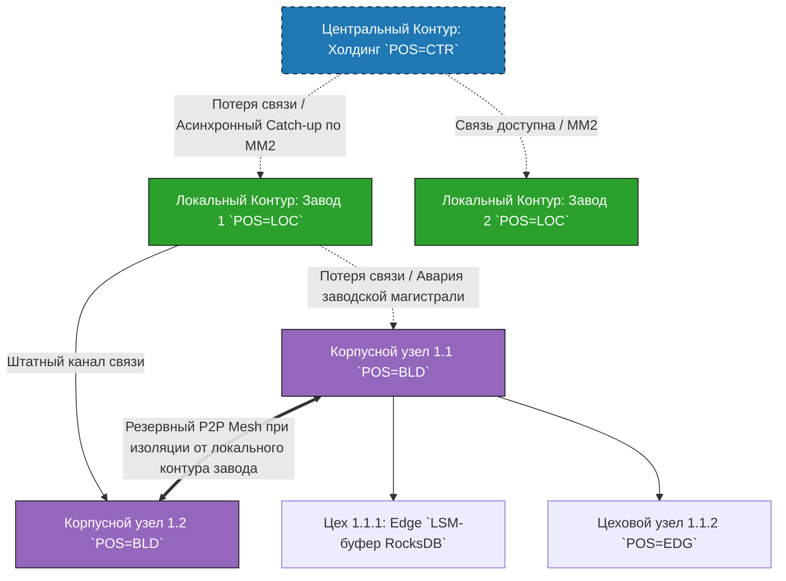
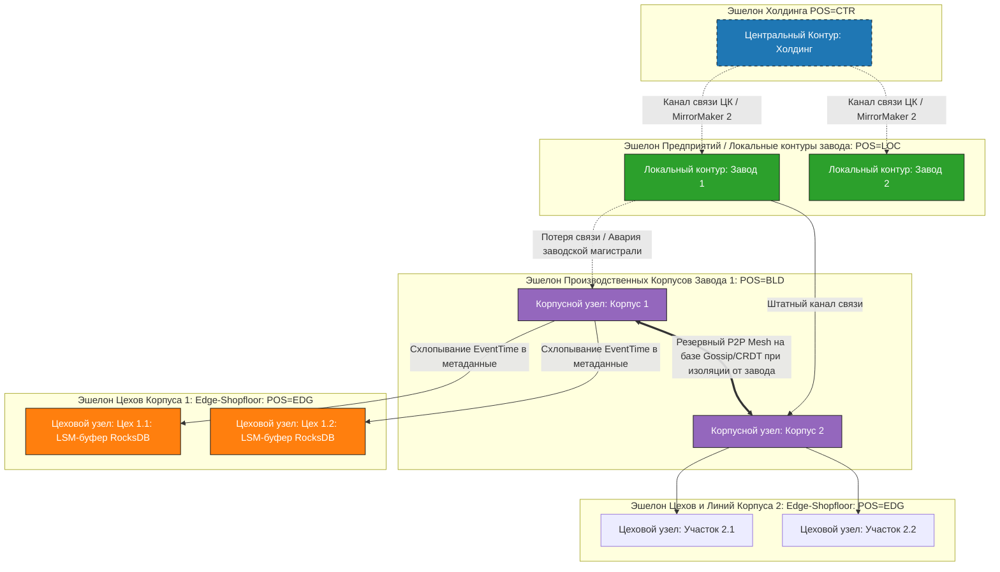
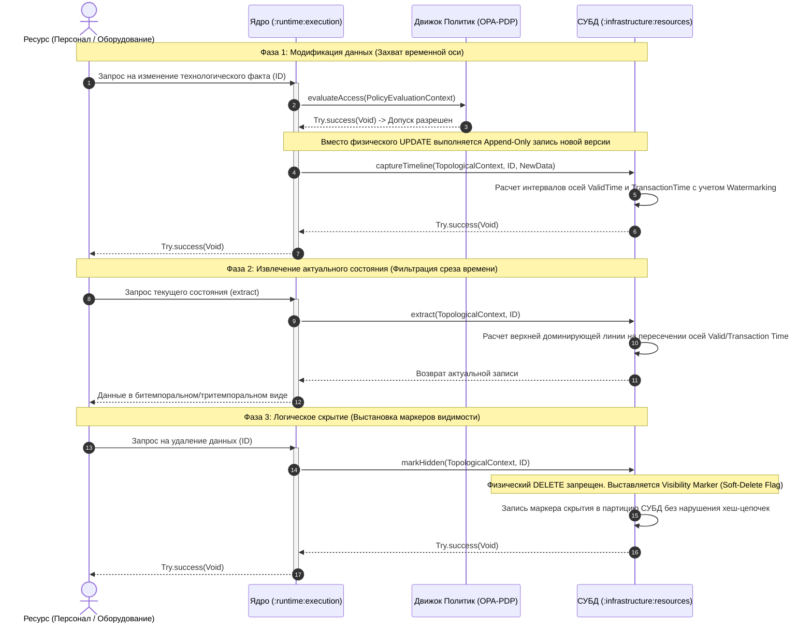
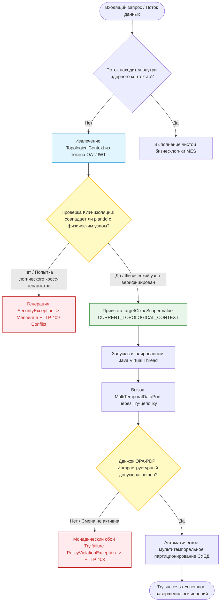
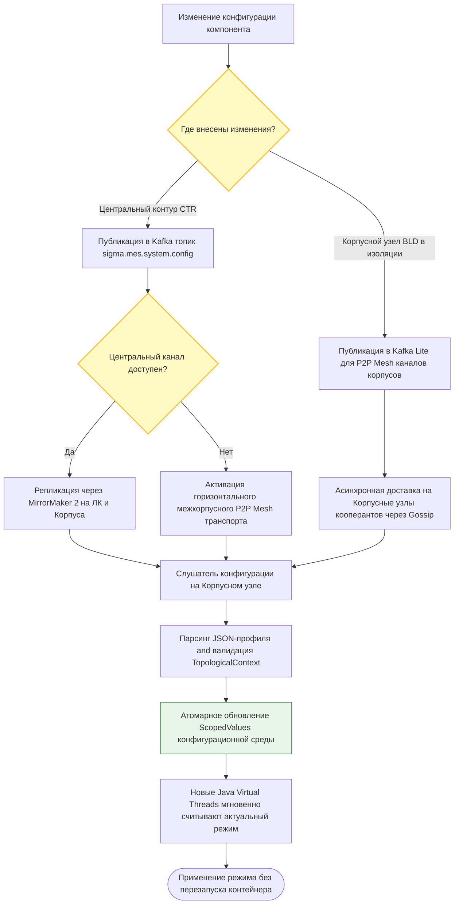
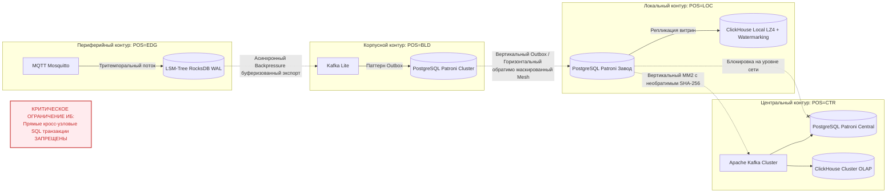

# Спецификация требований на ядерные инфраструктурные механизмы управления распределенно-вычислительными контекстами, топологической видимостью и мультитемпоральным хранением данных

---
# 1. Введение

## 1.1. Назначение

Настоящая спецификация требований определяет полные, атомарные технические требования к проектированию и реализации сквозных ядерных механизмов управления распределенно-вычислительными контекстами (предприятия, подразделения), контекстами пользователей/ресурсов, а также областями видимости, действия и изоляции транзакционных данных в рамках иерархической топологии развертывания («Снежинка») цифровой производственной платформы **DMP СИГМА.MES+** (далее — Ядро или Платформа).

Настоящий документ выступает в качестве расширения базовых технических требований к Ядру, закрепленных в спецификациях `PlatformCore.SRS-01` (базовый каркас) и `PlatformCore.SRS-02` (интеграция Keycloak и OAT). Спецификация служит строгим техническим заданием для системных и инфраструктурных архитекторов, определяя устройство портов, адаптеров и контекстных процессоров Платформы в условиях территориально распределенной обработки информации ограниченного доступа.

## 1.2. Область действия

Реализация механизмов контекстуализации, топологического разграничения и распределенной обработки данных охватывает:

- **Доменный слой Ядра (`:domain:abstraction`, `:domain:ports`):** разработка неизменяемых моделей топологических иерархических контекстов, би- и тритемпоральных структур данных и контрактов их динамического вычисления.
- **Слой исполнения и маршрутизации (`:runtime:execution`, `:runtime:routing`):** реализация контекстных интерцепторов (перехватчиков), процессоров распространения контекста в пуле виртуальных потоков Java (`Java Virtual Threads`), механизмов динамического распределения конфигурационных профилей и механизмов децентрализованного корпусного Mesh-обмена данными между узлами в условиях изоляции.
- **Инфраструктурно-ресурсную группу (`:infrastructure:core`, `:infrastructure:resources`):** проектирование распределенных транзакционных и аналитических хранилищ с поддержкой сквозного секционирования (партиционирования) по признакам предприятия/корпуса/цеха и темпоральным осям в условиях деградации и восстановления каналов связи.
- **Контур управления жизненным циклом данных:** реализация портов сбора, записи, систематизации, накопления, долговременного хранения, извлечения, использования, передачи в рамках распространения, предоставления или доступа, агрегации, обезличивания, маркирования (логического блокирования/скрытия) и логического уничтожения данных.

## 1.3. Термины, определения и сокращения

| Термин | Определение |
|---|---|
| **Топология «Снежинка» (Snowflake Topology)** | Архитектурная модель иерархического развертывания узлов Платформы, где центральный узел холдинга (ЦК) связан с радиальными локальными узлами заводов (ЛК), выступающими концентраторами для нижестоящих корпусных и цеховых вычислических контуров. |
| **Корпусной узел (Building Node: POS=BLD)** | Промежуточный инфраструктурный концентратор Ядра на уровне производственного корпуса, обеспечивающий локальную агрегацию данных, динамическую маршрутизацию, тритемпоральную конвертацию и горизонтальный P2P Mesh-обмен между корпусами при изоляции от завода. |
| **P2P Mesh-кооперация корпусов** | Механизм прямого горизонтального обмена транзакционными сообщениями и конфигурациями между корпусными узлами одного завода через резервные цеховые каналы связи в обход локального контура завода. |
| **Топологический контекст (Topological Context)** | Системный инвариантный кортеж метаданных, однозначно определяющий место выполнения операции в физической и организационной структуре холдинга (Идентификатор Холдинга $\rightarrow$ Идентификатор Завода $\rightarrow$ Идентификатор Корпуса $\rightarrow$ Идентификатор Цеха $\rightarrow$ Идентификатор Линии/Участка). |
| **Распределенно-вычислительный контекст (Distributed Evaluation Context)** | Изолированная среда выполнения бизнес-логики (транзакции, потока данных, аналитического расчета), обогащенная параметрами конкретного физического узла развертывания, Trace ID, Tenant ID и ограничениями связности, гарантирующая локальную изоляцию транзакций. |
| **Битемпоральная модель хранения** | Метод организации данных, при котором каждая запись снабжается двумя независимыми временными осями: временем действия факта в реальном мире (Valid Time) и временем регистрации факта в системе (Transaction Time), полностью исключающий физическую модификацию записей. |
| **Тритемпоральная модель хранения** | Расширение битемпоральной модели для Edge-слоя, добавляющее третью ось времени — время оперативного учета события (Decision/Event Time), фиксирующее момент физического совершения операции на промышленном оборудовании. |
| **Захват временной оси** | Механизм разрешения конфликтов в мультитемпоральных хранилищах, при котором внесение изменений осуществляется путем добавления новой записи, перекрывающей конфликтный интервал на временной оси без модификации исторических данных. |
| **Маркер логической изоляции (Soft-Deletion / Visibility Marker)** | Системный атрибут записи, ограничивающий её видимость для прикладных слоев MES без физического удаления с носителя информации. |
| **Configuration Delivery Engine** | Ядерная подсистема динамического иерархического распространения и горячего применения (Hot Reload) конфигурационных параметров функционирования компонентов без перезапуска приложений. |
| **Watermarking (Временные метки задержки)** | Механизм отслеживания и обработки несвоевременно прибывших данных (Out-of-Order Data) в распределенных темпоральных СУБД для обеспечения корректности инкрементального пересчета аналитических агрегатов. |

## 1.4. Нормативные ссылки

При проектировании и реализации подсистемы используются следующие нормативно-технические документы:

| Наименование | Описание |
|---|---|
| **PlatformCore.SRS-01 (Базовое ядро платформы)** | Редакция 1.0.4.0: правила гексагональной изоляции, использование RocksDB для Edge-слоя и пула Java Virtual Threads. |
| **PlatformCore.SRS-02 (Интеграция поставщика удостоверений)** | Редакция 1.3.0.0: структура OAT, профили ресурсов (ProductionResource), модель Try<T>, движок OPA, обратимое маскирование. |
| **Архитектурное описание системы «Цифровая производственная платформа СИГМА.MES+»** | Описание основных технических и архитектурных решений, принятых при проектировании СИГМА.MES+. |
| **Федеральный закон от 27.07.2006 № 152-ФЗ «О персональных данных»** | Статьи 5, 18, 21: в части регулирования процессов сбора, уточнения, обезличивания и блокирования данных. |
| **Требования ФСТЭК России / ФСБ России / Роскомнадзора в части КИИ (Критическая информационная инфраструктура)** | Регуляторные ограничения на совместное использование вычислительных ресурсов и сред хранения данных ограниченного доступа (запрет Shared-Nothing Multitenancy на логическом уровне). |

---
# 2. Общее описание и архитектурный контекст

## 2.1. Концепция topology «Снежинка» и физическая изоляция КИИ

В соответствии с нормативно-правовой базой по обеспечению безопасности КИИ, в рамках Ядра платформы DMP СИГМА.MES+ действует **жесткий запрет на реализацию логической многоарендности (Multitenancy)**, при которой данные разных юридических лиц или независимых предприятий обрабатываются в рамках одного разделяемого экземпляра приложения и базы данных.

Вместо этого Ядро реализует модель **развёртывания изолированных узлов (Isolated Node Deployment)**:

- Каждый узел холдинга (лучи и периферия «Снежинки») представляет собой аппаратно или виртуально обособленный экземпляр Платформы, развернутый на выделенных вычислительных ресурсах конкретного предприятия, его эксплуатирующего.

- Горизонтальное резервирование на межзаводском уровне холдинга (POS=CTR $\leftrightarrow$ POS=LOC) в рамках ближайшего релизного цикла исключено из основного сценария.

- Внутризаводская топология децентрализуется до уровня Производственных корпусов (`POS=BLD`). Корпусные узлы связывают Edge-контуры цехов (`POS=EDG`) с локальным заводским контуром и обеспечивают локальную автономную Mesh-кооперацию между корпусами при авариях на центральной заводской магистрали.

Логическая схема связанности при деградации локального и центрального каналов:



## 2.2. Архитектурные принципы и границы Ядра

- **Локальная транзакционная изоляция (Avoid Distributed Transactions):** Платформа проектируется с минимизацией условий для применения распределенных транзакций. Любая бизнес-операция должна выполняться атомарно в рамках локально-вычислительного контекста конкретного узла. Межконтурное взаимодействие и синхронизация строятся на принципах асинхронной консистентности в конечном итоге (Eventual Consistency). Поддержка паттерна Saga на уровне ядра Temporal выступает в качестве fallback-механизма для долговременных межзаводских бизнес-процессов кооперации.
- **Принцип абсолютной неизменяемости (Append-Only Режим):** Физическое удаление (DELETE) или модификация (UPDATE) записей в базах данных Ядра запрещены на уровне СУБД-адаптеров. Все исторические изменения сохраняются в виде новых записей с темпоральными метками. Разрешение коллизий и актуализация данных выполняются исключительно через механизм захвата временной оси.

---
# 3. Конкретные требования

## 3.1. Функциональные требования (Functional Requirements)

### Модель распределенно-вычислительных контекстов и топологической видимости

- **REQ-F-AUTH-029: Структура доменного топологического контекста (Topological Context Tuple)**

  В слое `:domain:abstraction` Ядра должна быть определена неизменяемая модель топологического контекста в виде Java Record `TopologicalContext`. Структура представляет собой иерархический неизменяемый кортеж метаданных, однозначно определяющий место инициации и выполнения операции в физической и организационной структуре холдинга с обязательной точностью до технологической линии (участка) на Edge-слое:
    - `holdingId` — уникальный буквенно-цифровой код холдинга (Pattern: `^[A-Z0-9]{3,8}$`);
    - `plantId` — уникальный код конкретного предприятия/завода, эксплуатирующего данный физически изолированный экземпляр Платформы;
    - `buildingId` — идентификатор производственного корпуса (`POS=BLD`);
    - `workCenterId` — идентификатор цеха/участка (Work Center, `POS=EDG`);
    - `productionLineId` — уникальный идентификатор технологической линии/производственного участка (Pattern: `^[A-Z0-9]{3,10}$`);
    - `nodeExecutionLevel` — перечисление `NodeLevel` (`CTR`, `LOC`, `BLD`, `EDG`), фиксирующее физический эшелон узла, на котором инициализирован контекст.

- **REQ-F-AUTH-030: Контекст выполнения вычислений и изоляция транзакций (Distributed Evaluation Context)**

  Ядро обязано расширять `SecurityContext` Spring Security компонентом `DistributedEvaluationContext`. При аутентификации производственного ресурса (через Keycloak JWT или локальный OAT по правилам `REQ-F-AUTH-008`), Ядро атомарно связывает `TopologicalContext` токена с текущим виртуальным потоком выполнения. Слой исполнения (`:runtime:execution`) обязан гарантировать, что все транзакционные операции, порожденные данным потоком, локализуются в пределах локальной БД узла, исключая генерацию распределенных транзакций между лучами топологии в синхронном режиме.

- **REQ-F-AUTH-031: Механизмы динамического вычисления области видимости данных (Data Scope Evaluation)**

  Слой маршрутизации (`:runtime:routing`) обязан предоставлять декларативный компонент `DataScopeEvaluator`. Компонент на основе `TopologicalContext` текущего потока и конфигурационной матрицы видимости определяет глубину доступа к данным:
    - Узел `EDG` (Цех) имеет область видимости, ограниченную собственным `workCenterId`, `productionLineId` и локальным тритемпоральным срезом.
    - Узел `BLD` (Корпус) видит агрегированные и детальные данные всех дочерних цехов и линий данного корпуса.
    - Узел `LOC` (Завод) видит битемпоральные данные всех дочерних корпусов (`buildingId`), цехов (`workCenterId`) и линий, но изолирован от транзакционных данных других заводов холдинга.
    - Узел `CTR` (Холдинг) обладает глобальной областью видимости аналитических витрин, оперируя дедуплицированными и обезличенными кросс-заводскими реестрами.

### Подсистема мультитемпорального хранения и партиционирования

- **REQ-F-AUTH-032: Сквозное автоматическое мультитемпоральное секционирование (Temporal Partitioning)**

  Ресурсный слой Ядра (`:infrastructure:resources`) обязан обеспечивать автоматическое горизонтальное секционирование баз данных PostgreSQL и ClickHouse на основе комбинации атрибутов топологии и времени: `plantId` + `buildingId` + `workCenterId` + `TransactionTime (Год/Месяц)`. Прикладной код MES-компонентов полностью изолирован от структуры секций; Ядро на уровне адаптеров СУБД автоматически перенаправляет запросы в целевые темпоральные партиции.

- **REQ-F-AUTH-033: Реализация функциональных портов обработки данных (Data Lifecycle Functional Ports)**

  В слое `:domain:ports:incoming` должен быть определен набор обобщенных функциональных портов управления жизненным циклом информации. Побочные эффекты вычислений и ошибки СУБД жестко канализируются через монаду `Try<T>`:

```java
package dmp.sigma.mes.core.domain.ports.incoming;

import io.vavr.control.Try;
import java.util.stream.Stream;

public interface MultiTemporalDataPort<ID, T> {
    Try<Void> record(TopologicalContext ctx, T data);    // Сбор и неизменяемая запись
    Try<T> extract(TopologicalContext ctx, ID id);       // Извлечение по срезу оси времени
    Try<Stream<T>> use(TopologicalContext ctx, PolicyEvaluationContext spec); // Использование/Фильтрация
    Try<Void> captureTimeline(TopologicalContext ctx, ID id, T updatedData);  // Захват временной оси (вместо Update)
    Try<Void> markHidden(TopologicalContext ctx, ID id); // Скрытие (вместо Delete/Purge)
}
```

- **REQ-F-AUTH-034: Поддержка мультитемпоральных моделей в зависимости от эшелона узла**

  Ядро обязано обеспечивать персистентное хранение записей в зависимости от уровня развертывания ноды:
   - **На эшелоне цеха (`POS=EDG`), корпуса (`POS=BLD`) и завода (`POS=LOC`):** Реализуется тритемпоральная модель (оси `ValidTime`, `TransactionTime`, `EventTime`).
   - **На эшелоне холдинга (`POS=CTR`):** Реализуется **битемпоральная модель**. Заводской узел (`POS=LOC`) при приеме данных снизу обязан в автоматическом режиме на уровне портов адаптера `:domain:plugins` осуществлять «схлопывание» временной оси `EventTime` в структуру метаданных, разгружая магистральные каналы связи завода и переводя хранение в битемпоральный инвариант.

- **REQ-F-AUTH-035: Разрешение конфликтов методом захвата временной оси и поддержка Watermarking**

  При слиянии версий данных или получении корректирующих транзакций Ядро активирует механизм захвата временной оси. Вместо физической модификации исторических записей, компонент `TimelineCapturer` записывает в партицию новую строку с идентичным бизнес-ключом, но сдвинутыми интервалами `ValidTime` и текущим системным `TransactionTime`. Прикладной запрос на чтение состояния (`extract`) всегда вычисляет актуальный срез как верхнюю доминирующую линию на пересечении временных осей.

  Для минимизации рисков несвоевременного прибытия данных (Out-of-Order Data) из-за длительной автономной работы Edge-узлов, СУБД-адаптеры Ядра обязаны использовать встроенные алгоритмы Watermarking. При задержке пакетов до 7 суток расчет аналитических срезов и материализованных представлений автоматически корректируется и инкрементально пересчитывается с учетом оси `EventTime`.

- **REQ-F-AUTH-036: Запрет физического уничтожения и внедрение маркеров видимости (Visibility Masking)**

  Выполнение физических операций `DELETE` и каскадных очисток данных на уровне Ядра категорически запрещено. Запросы на удаление информации обязаны транслироваться портом `markHidden()` в операцию записи системного маркера видимости (`Visibility Marker / Soft-Delete Flag`). Запись физически остается в партиции СУБД для обеспечения криптографической целостности хеш-цепочек аудит-лога (`REQ-F-AUTH-016`), но автоматически скрывается от прикладного MES-слоя.

### Внутризаводская Корпусная Mesh-кооперация и горизонтальное взаимодействие

- **REQ-F-AUTH-037: Горизонтальный P2P Mesh-обмен между корпусными контурами**

  Для компенсации рисков длительной недоступности локального контура завода (`POS=LOC`), Слой интеграции Ядра корпусного узла (`POS=BLD`) обязан поддерживать режим горизонтальной Mesh-кооперации:
    - При фиксации изоляции от ЛК завода, корпусные узлы (`POS=BLD`) активируют резервные маршруты обмена сообщениями напрямую со смежными корпусными узлами (через выделенные межкорпусные каналы связи).
    - Прямой межкорпусной обмен осуществляется асинхронно через локальные экземпляры Kafka Lite.
    - Топологический контекст (`TopologicalContext`) и Trace ID отправителя при этом сохраняются в заголовках сообщений, гарантируя сквозную прозрачность операций внутри завода без участия центрального заводского брокера.

- **REQ-F-AUTH-038: Механизмы обратимого токенизирования персональных данных при Mesh-транспорте**

  В целях соблюдения требований Федерального закона № 152-ФЗ «О персональных данных» и сохранения полной сквозной прослеживаемости производственного брака при межкорпусной кооперации в рамках одного завода, применение необратимого хеширования персональных данных (PII) и табельных номеров на горизонтальных Mesh-каналах `POS=BLD` запрещено.
  При передаче сообщений по горизонтальным каналам P2P Mesh-кооперации между корпусными узлами, Ядро обязано в автоматическом режиме применять правила обратимого динамического токенизирования (Tokenization) и маскирования коммерческой тайны. Компонент `DataAnonymizer` обязан осуществлять подмену оригинальных идентификаторов и табельных номеров сотрудников на динамические временные маркеры безопасности на базе локального ядерного Vault-сервиса. Необратимое хеширование (SHA-256 с солью `SECURITY_AUDIT_SECRET_KEY`) применяется строго при передаче аналитических и аудит-логов за пределы завода на верхний эшелон Холдинга (`POS=CTR`).

### Подсистема динамического распространения конфигурационных данных

- **REQ-F-AUTH-039: Иерархическая модель конфигурационных профилей (Topological Configuration Inheritance)**

  Ядро Платформы в слое `:runtime:routing` должно реализовывать подсистему распределенного управления конфигурациями (Configuration Delivery Engine), определяющую режимы функционирования компонентов. Конфигурация наследуется строго в соответствии с `TopologicalContext`: параметры холдинга (`CTR`) $\rightarrow$ параметры завода (`LOC`) $\rightarrow$ параметры корпуса (`BLD`) $\rightarrow$ параметры цеха (EDG).

- **REQ-F-AUTH-040: Горизонтальная доставка конфигураций корпусов в изоляции**

  В условиях деградации связи и изоляции от заводского контура, Платформа обязана поддерживать горизонтальное распространение критических конфигурационных профилей между корпусными узлами по каналам P2P Mesh-кооперации, используя локальные шины Kafka Lite. Применение настроек должно происходить динамически без перезапуска контейнеров на базе механизмов `ScopedValues` (`REQ-F-AUTH-041`).

### Инфраструктурно-ресурсные механизмы (Data Storage Infrastructure & Engines)

- **REQ-F-AUTH-042: Персистентная изоляция транзакций на уровне СУБД (PostgreSQL Patroni Cluster)**

  Каждый экземпляр ЛК завода (`POS=LOC`) и корпусного узла (`POS=BLD`) обслуживается выделенным кластером PostgreSQL (под управлением Patroni). Прямые синхронные кросс-узловые SQL-транзакции категорически запрещены. Все межузловые операции фиксируются локально и выносятся в асинхронный интеграционный слой посредством паттерна Transactional Outbox.

- **REQ-F-AUTH-043: Механизмы LSM-буферизации Edge-телеметрии и Backpressure**

  В целях исключения рисков потери данных промышленного контура при аварийных сбоях электропитания (Power Fails) и обеспечения соответствия базовому ядру Платформы (`PlatformCore.SRS-01`, `REQ-F-010`), использование реляционных файловых баз данных (включая SQLite) на эшелоне цеха (`POS=EDG`) строго запрещено.
  На эшелоне цеха (`POS=EDG`) Ядро обязано использовать встроенную высокопроизводительную СУБД RocksDB с LSM-структурой дерева слияния для локальной тритемпоральной буферизации телеметрии. Запись выполняется в режиме WAL (Write-Ahead Logging). Порт `MultiTemporalDataPort` на уровне адаптера реализует стратегию обратного давления Buffer-or-Block: при превышении пропускной способности сети или задержках в Patroni, входящий высокочастотный поток (до 100 000 сигналов/сек на ноду) атомарно сбрасывается в локальный WAL RocksDB, полностью предотвращая риски Out-Of-Memory (OOM).

- **REQ-F-AUTH-044: Аналитическое сжатие и хранение мультитемпоральных витрин (ClickHouse LZ4 Engine)**

  На эшелонах `LOC` и `CTR` для долгосрочного хранения и анализа битемпоральных рядов данных должен использоваться ClickHouse с алгоритмом сжатия LZ4 и движками семейства `ReplacingMergeTree`. Ключом сортировки (`ORDER BY`) выступает кортеж `(plantId, buildingId, workCenterId, ValidTime, TransactionTime)`.
  
  В целях исключения рисков выдачи недостоверных или задвоенных аналитических данных конечному пользователю MES при просмотре исторических отчетов для витрин, собирающих данные с Edge-узлов, подверженных задержкам прибытия данных (Out-of-Order) до 7 суток, вместо `ReplacingMergeTree` использовать движок `ReplacingMergeTree` с явным указанием версии (`TransactionTime`) и обязать прикладной слой MES при формировании отчетности использовать системное макро-расширение `FINAL` или агрегатные функции семейства `argMax`, гарантирующие вычисление актуального темпорального среза до завершения фонового слияния блоков в ClickHouse.

- **REQ-F-AUTH-045: Каскадная синхронизация темпоральных буферов**

  В целях предотвращение каскадного отказа («шторма обновлений») промежуточных инфраструктурных узлов после длительных периодов изоляции производственных контуров ядро обязано, при восстановлении вертикального канала связи `POS=EDG` -> `POS=BLD` -> `POS=LOC`, выполнять инкрементальный контролируемый Catch-up. Скорость вычитки данных из RocksDB (эшелон `EDG`) и передачи в Kafka Lite (эшелон `BLD`) должна динамически регулироваться (Rate-Limiting) на основе метрик загрузки CPU и дискового I/O целевого кластера PostgreSQL Patroni, не допуская деградации транзакционного слоя выполнения оперативных MES-задач. .

## 3.2. Нефункциональные требования (Non-Functional Requirements)

- **REQ-NF-AUTH-009: Изоляция контекста в легковесных потоках и ScopedValues**

  Переключение топологических контекстов и контекстов вычислений внутри пула Java Virtual Threads не должно превышать 0.01 миллисекунды. Стратегия распространения контекста обязана опираться на механизмы `ScopedValues` (JDK 25) для обеспечения немутируемости (immutability) контекстной среды.

- **REQ-NF-AUTH-010: Пропускная способность и накладные расходы темпорального движка**

  Инфраструктурные перехватчики Ядра обязаны обрабатывать поток данных с частотой до 0.1 секунды на одну единицу оборудования при плотности до 100 000 сигналов в секунду на один цеховой узел (`POS=EDG`). Добавочная задержка (`overhead`) не должна превышать 0.2 миллисекунды на одно транзакционное событие.

- **REQ-NF-AUTH-011: Отказоустойчивость, глубина хранения и Eventual Consistency Mesh-маршрутов**

  При полной потере связи с заводским узлом, локальные механизмы P2P Mesh-кооперации корпусов обязаны автоматически перенаправлять транзакционные сообщения на горизонтальные линки в течение не более 30 секунд с момента фиксации деградации канала.
  В целях предотвращения эффекта мерцания лидера (Leader Flapping) и минимизации паразитного сервисного трафика на нестабильных резервных линиях связи цехов, использование синхронного Raft-консенсуса для горизонтального обмена заблокировано. Синхронизация списков отзыва токенов (OTRL) и конфигураций переведена на децентрализованную модель Eventual Consistency на основе протоколов Gossip и бесконфликтно реплицируемых типов данных (CRDT).
  Персистентный буфер накопления логов и транзакционных данных для Mesh-маршрутов на эшелоне Производственных корпусов (`POS=BLD`) обязан иметь глубину удержания не менее 30 суток (720 часов) для обеспечения гарантированной выживаемости контура в условиях затяжной изоляции.

---
# 4. Дополнительные требования

## 4.1. Матрица контроля мультитемпоральных операций над данными в КИИ-топологии

| Операция над данными | Механизм реализации в Ядре платформы | Ограничения ИБ и надежности в КИИ-узлах «Снежинки» |
|---|---|---|
| **Сбор и Запись** | Порт `record()`, тритемпоральная фиксация в LSM-структуре на эшелоне POS=EDG. | Автоматическое присвоение неизменяемого TopologicalContext с точностью до линии. Запрет Shared-ресурсов баз данных. |
| **Систематизация и Накопление** | Автоматическое мультитемпоральное партиционирование СУБД PostgreSQL/ClickHouse. | Физическая изоляция данных на узлах предприятий и корпусов. Исключение логического мультитенантства. |
| **Хранение и Архивирование** | Паттерн Append-Only. Автоматическое схлопывание тритемпоральной модели в битемпоральный инвариант адаптером на `POS=BLD`. | Глубина хранения логов: на `POS=BLD` $\ge$ 30 суток; на `POS=LOC` $\ge$ 1 года; на `POS=CTR` $\ge$ 3 лет. Запрет физического удаления. |
| **Уточнение и Извлечение** | Порт `captureTimeline()`, механизм захвата временной оси. | Вычисление актуального среза поверх исторических линий. Поддержка Watermarking для Out-of-Order данных. Исторические данные не мутируют. |
| **Передача и Распространение** | Асинхронная репликация через MirrorMaker 2 (вертикально) или Kafka Lite P2P Mesh корпусов (горизонтально). | Обязательное автоматическое обратимое токенизирование PII компонентом DataAnonymizer для Mesh-каналов `POS=BLD`. Хеширование SHA-256 только при выходе на `POS=CTR`. |
| **Блокирование и Скрытие** | Порт `markHidden()`, выставление системных маркеров видимости. | Запись остается в партиции СУБД для целостности хеш-цепочек. Блокировка чтения для прикладного MES-слоя. |

## 4.2. Архитектурный контракт контекстного процессора (Пример реализации для разработчиков Ядра)

```java
package dmp.sigma.mes.core.runtime.execution;

import dmp.sigma.mes.core.domain.ports.incoming.TopologicalContext;import io.vavr.control.Try;import lombok.extern.slf4j.Slf4j;

@Slf4j
public class DistributedContextProcessor {

    // Использование ScopedValue (JDK 25) вместо ThreadLocal для жесткой изоляции и неизменяемости контекста
    public static final ScopedValue<TopologicalContext> CURRENT_TOPOLOGICAL_CONTEXT = ScopedValue.newInstance();

    /**
     * Выполняет прикладную бизнес-задачу внутри изолированного топологического контекста узла предприятия.
     * Полностью исключает риски перекрестного загрязнения данных (Context Bleeding) и распределенных транзакций.
     */
    public <T> Try<T> executeInNodeContext(TopologicalContext targetCtx, java.util.function.Supplier<Try<T>> businessLogic) {
        if (targetCtx == null) {
            return Try.failure(new IllegalArgumentException("Topological контекст узла предприятия не может быть null"));
        }

        log.debug("Инициализация вычислительного контекста для Завода: {}, Корпуса: {}, Цеха: {}, Линии: {}",
            targetCtx.plantId(), targetCtx.buildingId(), targetCtx.workCenterId(), targetCtx.productionLineId());

        // Привязка контекста к scope выполнения виртуального потока. Контекст становится иммутабельным
        return ScopedValue.where(CURRENT_TOPOLOGICAL_CONTEXT, targetCtx)
            .call(() -> {
                try {
                    return businessLogic.get();
                } catch (Exception e) {
                    return Try.failure(e);
                }
            });
    }

    /**
     * Безопасное извлечение текущего топологического контекста из шины исполнения Платформы
     */
    public static Try<TopologicalContext> extractCurrentContext() {
        if (!CURRENT_TOPOLOGICAL_CONTEXT.isBound()) {
            return Try.failure(new IllegalStateException("Поток вычислений запущен вне ядерного топологического контекста"));
        }
        return Try.success(CURRENT_TOPOLOGICAL_CONTEXT.get());
    }
}
```

## 4.3. Архитектурные визуальные модели

### Модель 1. Логическая схема связанности при деградации локального и центрального каналов

На схеме представлена полная иерархия развертывания с соблюдением правила кратности (у каждого вышестоящего узла отображено не менее двух дочерних узлов). Канал связи с Центральным Контуром (Холдингом) обозначен пунктирной линией, а горизонтальные каналы Mesh-кооперации перенесены на уровень Производственных корпусов.



### Модель 2. Диаграмма последовательности мультитемпоральных транзакций



### Модель 3. Блок-схема фильтрации и контекстуализации данных в `SecurityFilterChain`



### Модель 4. Блок-схема иерархического распространения и Hot-Reload конфигураций



### Модель 5. Физическая топология инфраструктурно-ресурсных механизмов хранения


