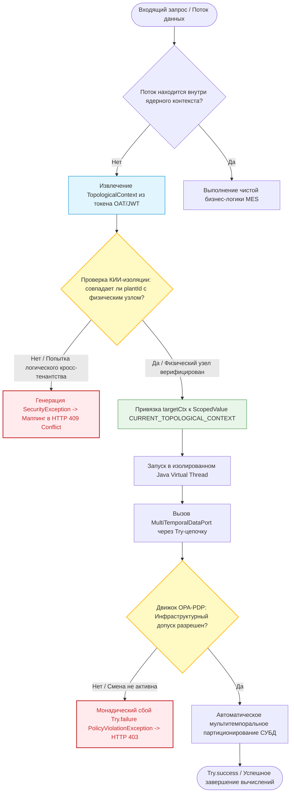

# Спецификация требований на интеграцию поставщика цифровых удостоверений и полиморфной автономной авторизации на базе Keycloak в базовое ядро платформы

**Редакция**: 1.3.0.1

---
# 1. Введение

## 1.1. Назначение

Настоящая спецификация требований определяет полные, атомарные, технические требования к интеграции поставщика цифровых удостоверений на базе Keycloak, а также к разработке параллельного полиморфного контура автономной аутентификации и допускного контроля производственных ресурсов: трудовых (персонал) и технологических (станки, терминалы) на основе специальных операционных кодов авторизации доступа (OAT) в условиях изоляции цеховых и корпусных контуров на уровне базового ядра цифровой производственной платформы DMP СИГМА.MES+ (далее — Ядро).

Документ служит расширением базового технического задания для разработчиков Платформы (PlatformCore.SRS-01). Он фиксирует структуру многомодульного проекта, правила валидации токенов OIDC/OAuth2, расширенную схему эшелонирования OAT, механизмы разграничения прав доступа на уровне методов (RBAC), а также предоставляет инфраструктурный фундамент (движок политик OPA) для прикладных алгоритмов MES.

## 1.2. Область действия

Реализация подсистемы аутентификации, авторизации и безопасного аудита охватывает:

- Настройку и расширение многомодульной структуры в рамках слоя управления доступом (`:runtime:auth`).

- Конфигурацию клиентской части Spring Security в качестве сервера ресурсов OAuth2 для работы в связке со Spring Boot 4.x в условиях использования Java Virtual Threads.

- Процесс валидации криптографических подписей JWT-токенов Keycloak и локальных кодов OAT, проверки сроков их действия и соответствия расширенным областям видимости КИИ-топологии.

- Декларативное управление доступом на уровне Java-методов (контроллеров и портов) на основе ролей (RBAC).

- Архитектуру автономного мультимодального ввода и полиморфного форматирования специальных кодов авторизации доступа ресурсов (OAT) для поддержки изоляции и децентрализации цеховых контуров.

- Механизм мгновенного распределенного отзыва кодов OAT через локальные высокопроизводительные списки отзыва (OTRL) на базе Kafka Lite с поддержкой протоколов консенсуса и контроль сессионности.

- Модель надежного журналирования событий аутентификации и авторизации с контролем целостности цепочек записей, конфиденциальности данных и обеспечением долговременной доступности (CIA-триада).

- Слой управления доступом (`:runtime:auth`), доменный слой (`:domain:abstraction`, `:domain:ports`).

## 1.3. Термины, определения и сокращения

| Термин | Определение |
|---|---|
| **Keycloak** | Открытое программное обеспечение для реализации централизованной аутентификации (SSO), авторизации и управления пользователями на корпоративном уровне. |
| **OIDC / OAuth2** | Протоколы аутентификации и авторизации над надстройкой OAuth 2.0 с использованием JWT-токенов. |
| **Производственный ресурс (Production Resource)** | Абстрактная доменная сущность Ядра, подлежащая обязательной идентификации и проверке. Разделяется на Трудовые ресурсы (персонал) и Технологические ресурсы (станки, датчики, терминалы). |
| **RBAC** | Role-Based Access Control — метод разграничения прав доступа по ролям. |
| **Инфраструктурный допуск** | Базовая проверка Ядром легитимности и подлинности OAT (проверка криптографии, срока действия и отсутствия в списках отзыва OTRL). |
| **Функциональная авторизация** | Проверка прикладным MES-методом бизнес-прав аутентифицированного ресурса на выполнение конкретной операции (например, «Начало смены», «Списание брака») в заданный момент времени. |
| **Политика OPA (Open Policy Agent)** | Декларативное правило на языке Рего (JSON/AST), вычисляемое встроенным движком Ядра по запросу прикладного слоя для динамической оценки контекста (смены, режимы работы оборудования). |
| **JWT (JSON Web Token)** | Компактный, безопасный для URL-адресов способ представления заявок на идентификацию/авторизацию, передаваемых между двумя сторонами, защищенный цифровой подписью. |
| **OAT (Operational Access Token)** | Специальный компактный авторизационный код (токен) производственного ресурса, формируемый локально и сериализуемый в бинарный формат CBOR для поддержки автономности изолированных эшелонов. |
| **Прямой ввод OAT** | Способ передачи токена, при котором в систему ввода (терминал, станок) напрямую поступает строковое значение самого кода OAT (например, расшифрованная строка штрих-кода или 2D QR-кода). |
| **Опосредованный ввод OAT** | Способ авторизации, при котором ресурс предъявляет внешний идентификатор (UID карты СКУД, сетевой ID станка, RFID-метка), а система транслирует его в ассоциированный OAT через механизмы Ядра. |
| **Генератор OAT** | Специализированная интерфейсная абстракция Ядра, определяющая унифицированный контракт выпуска и криптографического подписания OAT с поддержкой внутренних и внешних доверенных систем. |
| **OTRL (Operational Token Revocation List)** | Высокопроизводительный распределенный список принудительного отзыва выданных кодов OAT, синхронизируемый между изолированными корпусными узлами. |
| **Обратимое маскирование (Токенизация)** | Замена чувствительных данных на суррогатные маркеры (токены) с возможностью их обратного восстановления в доверенном контуре безопасности (Nuclear Vault). |
| **Профиль производственного назначения** | Совокупность оперативных цеховых данных штатной расстановки трудового ресурса на момент проверки (рабочая смена, зона допуска, квалификационная роль), определяющая его текущие полномочия в MES. Не является кадровым делом (HRM). |
| **Технический профиль оборудования** | Совокупность технологических параметров и метаданных технологического ресурса (ID станка, цеховая привязка, список базовых разрешенных операций). |

## 1.4. Нормативные ссылки

При разработке подсистемы используются следующие нормативно-технические документы:

- **PlatformCore.SRS-01 (Базовое ядро платформы)**: Редакция 1.0.4.0 — правила гексагональной изоляции, использование RocksDB для Edge-слоя и Java Virtual Threads.
- **PlatformCore.SRS-03 (Мультитемпоральное хранение)**: Редакция 1.0.3.0 — концепция топологии «Снежинка», распределенные контексты, би- и тритемпоральные СУБД-адаптеры.
- **RFC 6749**: Спецификации OpenID Connect Core 1.0 и The OAuth 2.0 Authorization Framework.
- **Приказ ФСТЭК России от 11 апреля 2025 г. № 117**:  Делает мультитенантную архитектуру экономически и технически нерентабельной для систем КИИ, обрабатывающих информацию ограниченного доступа.
- **Руководящий документ Гостехкомиссии России от 30.03.1992**: Классификация автоматизированных систем и требования по защите информации от НСД.
- **Федеральный закон от 27.07.2006 № 152-ФЗ «О персональных данных»**: Статья 5.

---
# 2. Общее описание

## 2.1. Архитектурный контекст и стек технологий

Компонент интеграции с Keycloak и подсистема локальной аутентификации ресурсов встраиваются в существующий технологический каркас Ядра платформы (PlatformCore.SRS-01) и функционируют в рамках гексагональной архитектуры. 

Слой безопасности должен быть адаптирован под Java Virtual THreads: контекст безопасности Spring Security (SecurityContextHolder) сохраняется и изолируется при переключении легковесных потоков вычислений через механизмы ScopedValues (JDK 25), полностью исключая риски перекрестного загрязнения данных (Context Bleeding) или смешивания контекстов разных пользователей при повторном использовании потоков.

## 2.2. Расширение структуры многомодульного проекта

В соответствии с гексагональной архитектурой Продукта («Порты и Адаптеры»), интеграция локализуется строго в рамках выделенных доменных, исполняемых и инфраструктурных слоев. Структура папок многомодульного Gradle-проекта должна быть расширена следующими подмодулями и компонентами:

```
dmp-sigma-mes-core/
├── domain/
│   ├── abstraction/                          // Определение неизменяемых моделей (Java Records)
│   │   ├── production/resource/models/
│   │   │   ├── ProductionResource.java       // Общий интерфейс-маркер ресурса
│   │   │   ├── ProductionStaffAssignment.java // Профиль цехового назначения (расстановка)
│   │   │   └── EquipmentTechnicalProfile.java // Технический профиль станка
│   │   ├── system/service/models/
│   │   │   └── ServiceAccessProfile.java     // Профиль безопасности системного сервиса
│   │   └── auth/
│   │       ├── PolicyEvaluationContext.java  // Контекст оценки политики (input для OPA)
│   │       └── OatInputCategory.java         // Категории ввода токена (DIRECT / MEDIATED)
│   └── ports/incoming/                       // Интерфейсы входящих/исходящих портов
│       ├── OperationalTokenGenerationPort.java // Порт генерации локальных кодов OAT
│       └── OperationalTokenRevocationPort.java // Порт принудительного отзыва OAT
├── runtime/auth/                             // Конфигурация Spring Security & Keycloak
│   ├── config/
│   │   └── SecurityConfiguration.java        // Настройка цепочки фильтров и Virtual Threads
│   ├── converter/
│   │   └── KeycloakRoleConverter.java        // Конвертер ролей (Mapping Claims → GrantedAuthority)
│   ├── audit/                                // Подсистема надежного логирования
│   │   ├── SecurityAuditLogger.java          // Перехватчик событий безопасности
│   │   ├── AuditChainSigner.java             // Расчет SHA-256 хеш-цепочки журналов
│   │   ├── AuditOutboxRepository.java        // Локальный буфер Outbox в PostgreSQL Patroni
│   │   └── IntegrityBreachReporter.java      // Маркировщик инцидентов для SOC ([CRITICAL_…])
│   ├── oat/                                  // Контур автономной авторизации ресурсов
│   │   ├── InputMethodAdapter.java           // Адаптер мультимодального ввода
│   │   ├── MediatedOatResolver.java          // Транслятор аппаратных ID в OAT-профили
│   │   ├── OperationalAuthentication.java    // Реализация Authentication для SecurityContext
│   │   ├── OperationalTokenDecoder.java      // Универсальный валидатор и CBOR-парсер структур OAT
│   │   └── OperationalTokenService.java      // Сервис расчета локальной подписи и выдачи OAT
│   ├── opa/                                  // Компоненты интеграции Open Policy Agent
│   │   └── LocalPolicyDecisionPoint.java     // Встроенный PDP-движок вычисления политик
│   └── revocation/                           // Подсистема контроля компрометации OAT (OTRL)
│       ├── LocalRevocationCache.java         // In-Memory кэш отозванных кодов в реальном времени
│       └── RevocationKafkaListener.java      // Слушатель топика синхронизации списков отзыва (Raft)
└── infrastructure/
├── core/                                 // Глобальный ExceptionHandler, логирование, SwaggerConfig
│   └── GlobalExceptionHandler.java       // Маппинг ошибок авторизации (401/403/409) в REST-ответы
└── resources/                            // Конфигурация DataSource (PostgreSQL, ClickHouse, Kafka)
├── repository/
│   └── BlacklistedTokenRepository.java // Persistent-хранилище OTRL в PostgreSQL
└── entity/
└── SecurityAuditEntity.java      // Техническая сущность таблицы аудита с полем hash
```

_(Разработчикам разрешено корректировать названия конкретных классов в процессе реализации при условии сохранения гексагонального разделения)._

## 2.3. Сквозные архитектурные решения и принципы Продукта

1. **Изоляция структуры OAT от физического и графического представления**: Структура токена OAT является чистой цифровой абстракцией. Генерация графических кодов (QR/штрих-кодов) должна находиться в обособленном прикладном модуле, способном полиморфно связывать графические/электронные метки с любым разрешенным объектом платформы по его типу и идентификатору.

2. **Полиморфизм контура автономной авторизации**: Все механизмы автономной проверки прав, локальной валидации и принудительного отзыва (OTRL) должны быть инвариантны относительно типа проверяемой сущности и в равной степени распространяются на физических лиц (персонал), единицы промышленного оборудования (станки, агрегаты) и системные сервисы через единый маркерный интерфейс `ProductionResource`.

3. **Децентрализация и абстрагирование генерации OAT**: Процесс выпуска и подписания токенов OAT должен быть выделен в изолированную абстракцию Ядра, позволяющую использовать как встроенный криптографический сервис, так и подключать внешние доверенные системы генерации.

4. **Декларативное управление доступом на основе политик (OPA)**: Вынесение логики принятия решений о допуске в прикладной (доменный) слой на базе методологии Open Policy Agent. Разрешение или запрет на выполнение операции вычисляется динамически на основе жестких критериев: принадлежности к рабочей смене (своя/чужая), привязки к конкретному оборудованию, технологическому контексту и другим свойствам/атрибутам сессии.

---
# 3. Конкретные требования

## 3.1. Функциональные требования

### Подсистема интеграции с Keycloak

- **REQ-F-AUTH-001: Безопасная подача параметров Keycloak**

  Конфигурация подключения к Keycloak должна собираться из переменных окружения (ENV) и конфигурационных файлов `application.yml`. Все секреты клиентов (Client Secrets), API-ключи и адреса внутренних инстансов Keycloak не должны храниться в кодовой базе в открытом виде и должны передаваться на этапе старта контейнера приложения через защищенные переменные среды.

- **REQ-F-AUTH-002: Режим OAuth2 Resource Server**

  Ядро должно быть сконфигурировано как OAuth2 Resource Server, принимающий токены типа Bearer в HTTP-заголовке `Authorization`. Валидация криптографической подписи JWT должна осуществляться автоматически с использованием JWK Set Endpoint (`realms/{realm-name}/protocol/openid-connect/certs`) внешнего инстанса Keycloak.

- **REQ-F-AUTH-003: Запрет мультитенантности**

  В соответствии с действующей нормативно-правовой базой (Приказ ФСТЭК России № 117), использование архитектуры Multi-tenancy на текущем этапе развития проекта нецелесообразно. В связи с этим, каждый развернутый узел Платформы должна обслуживать строго одна выделенная для него область безопасности (Realm) Keycloak.

  Конфигурация нескольких поставщиков цифровых удостоверений или динамическое определение области безопасности на основе входящего запроса запрещены на уровне исходного кода.

- **REQ-F-AUTH-004: Шаблон идентификатора клиента и его валидация**

  На уровне статической конфигурации должен быть установлен ровно один иерархический шаблон для Client ID в Keycloak вида: `SIGMA.MES.$OWNR.$POS.$ID`, где:
    - `$OWNR` — идентификатор владельца системы (заглавные латинские буквы и цифры);
    - `$POS` — признак узла: LOC — локальный, CTR — центральный;
    - `$ID` — уникальный числовой номер узла системы.

  Ядро в слое `:runtime:auth` должно содержать конфигурационный компонент `ClientIdValidator`, проверяющий на этапе запуска приложения соответствие инжектируемого Client ID регулярному выражению: `^SIGMA\.MES\.[A-Z][A-Z0-9]*\.(LOC|CTR)\.\d+$`. При несоответствии запуск приложения должен аварийно завершаться со специализированной ошибкой `IllegalAuthClientIDException`.

- **REQ-F-AUTH-005: Парсинг и конвертация ролей**

  Реализовать конвертер JWT-токенов вида: `Converter<Jwt, AbstractAuthenticationToken>`, который извлекает роли пользователя из секций токена Keycloak:
    - `realm_access.roles`: для извлечения субъектной роли;
    - `resource_access.{client_id}.roles`: для извлечения функциональной роли.

   Каждая полученная роль должна быть преобразована в объект типа `GrantedAuthority` с префиксом `ROLE_`.

- **REQ-F-AUTH-006: Разграничение прав на уровне методов - RBAC**

  Включить глобальную поддержку аннотаций безопасности методов в режиме: `@EnableMethodSecurity(jsr250Enabled = true, prePostEnabled = true)`. Обеспечить возможность ограничения доступа к методам портов (`:domain:ports`) и контроллеров с помощью аннотаций `@PreAuthorize` и `@RolesAllowed`.

### Децентрализованная абстракция генерации OAT

- **REQ-F-AUTH-007-01: Унифицированный интерфейс генератора**

  В слое `:domain:ports:incoming` должна быть определена интерфейсная абстракция `OatGeneratorProvider`. Компоненты Ядра не должны иметь жесткой зависимости от внутренней реализации криптографического алгоритма выпуска и подписи токенов.

- **REQ-F-AUTH-007-02: Конфигурация стратегии генерации**

  Способ генерации OAT определяется на этапе запуска приложения через переменную окружения `SECURITY_OAT_GENERATOR_STRATEGY` и может принимать значения:
    - `INTERNAL`: выпуск силами самого Ядра Платформы;
    - `EXTERNAL`: делегирование выпуска внешней доверенной криптографической системе;
    - `MIXED`: смешанный из выше определённых стратегий.

- **REQ-F-AUTH-007-03: Поддержка внешних кодов OAT**

  В режиме `EXTERNAL` Ядро отключает локальные эндпоинты выпуска, переходит в режим Resource Server для кодов OAT и использует зарегистрированный инфраструктурный плагин для импорта и валидации открытых ключей проверки подписи сторонней системы, сохраняя неизменным внутренний цикл фильтрации и аутентификации.

- **REQ-F-AUTH-011: Полиморфные форматы вывода OAT**

  Интерфейс `OperationalTokenGenerationPort` должен поддерживать форматирование токена в зависимости от направления использования на базе перечисления `OatOutputFormat`:
    - `BASE64_URL` — для QR-кодов.
    - `HEX_STRING` — для прошивки RFID-меток, отображаемый в кэше Ядра на полный OAT-профиль.
    - `NUMERIC_RAW` — для печати штрих-кодов.
    - `PIN_SHORT` — короткий цифровой код (6–8 знаков), отображаемый в кэше Ядра на полный OAT-профиль.

### Полиморфный контур автономной авторизации и управления сессиями

- **REQ-F-AUTH-008: Унифицированная техническая валидация профилей ресурсов**

  Каждому локальному коду OAT при выпуске присваивается подписанный профиль, состав атрибутов которого строго валидируется Ядром в зависимости от типа сущности `ProductionResource`:
    - _Для персонала (Профиль производственного назначения):_ Идентификатор подразделения, номер цеха, квалификационная роль, табельный номер сотрудника, сроки предоставления операционных полномочий (`validFrom ... validTo`). Наличие прямых кадровых данных и окладов (HRM) запрещено.
    - _Для оборудования (Технический профиль оборудования):_ Уникальный ID оборудования, класс и тип оборудования, цеховая привязка, список разрешенных базовых технологических операций.
    - _Для системных сервисов (Профиль сервиса):_ Идентификатор компонента, область видимости API, права на межсистемное взаимодействие, токен-идентификатор родительского процесса.

- **REQ-F-AUTH-009: Архитектура мультимодального ввода и правила маскирования ПДн**

  Компонент `InputMethodAdapter` в `OperationalTokenFilter` обязан обрабатывать входящие данные и приводить их к единой внутренней структуре на основе двух категорий ввода (`OatInputCategory`):
    - _Категория ПРЯМОГО ввода:_ Считывание непосредственно строкового значения самого токена OAT (сканирование текстовой строки штрих-кода или 2D QR-кода терминалом).
    - _Категория ОПОСРЕДОВАННОГО ввода:_ Передача внешнего суррогатного аппаратного/логического идентификатора. Компонент `MediatedOatResolver` выполняет трансляцию полученного идентификатора в ассоциированный OAT-код через локальное защищенное хранилище PostgreSQL (с кэшированием в Caffeine, TTL = 8 часов):
        - Для персонала: ручной ввод цифрового ПИН-кода с проверкой контрольного числа, считывание UID или защищенного блока памяти физической карты доступа СКУД.
        - Для оборудования: перехват MAC-адреса, UUID промышленного контроллера или ID порта подключения физического устройства.
        - Для сервисов: обработка уникального логического ID программного компонента или сессионного токена межсервисного взаимодействия.
    - Юрисдикция ПДн (ФЗ № 152): Внутрицеховая и межцеховая передача данных в рамках одного завода (одной юрисдикции КИИ) осуществляется с сохранением оригинальных табельных номеров сотрудников (при наличии корпоративного согласия от сотрудника). Необратимое хеширование (SHA-256) должно применяться строго при передаче аналитических логов на верхний эшелон Холдинга (POS=CTR). Для защиты межцеховых Mesh-каналов на уровне Производственных корпусов (POS=BLD) разрешено применять обратимое токенизирование (динамическую подмену маркеров) на базе локального ядерного Vault-сервиса.

- **REQ-F-AUTH-010: Локальная криптографическая проверка подписи (Автономность)**

  Каждый локальный код OAT должен быть подписан секретным ключом `SECURITY_AUDIT_SECRET_KEY`. Модуль `:runtime:auth` выполняет локальную валидацию структуры кода и проверку срока его действия без обращения к Keycloak, присваивая внутренний `SecurityContext` с назначением соответствующей роли (`ROLE_OPERATIONAL_WORKER` для персонала). Операция проверки на локальных узлах (`POS=LOC, POS=BLD`) выполняется полностью автономно в условиях отсутствия связи с центральным контуром.

- **REQ-F-AUTH-028: Управление сессионностью ресурсов и поддержка режима «многостаночника»**

  Компонент `InputMethodAdapter` совместно с `OperationalTokenFilter` в слое `:runtime:auth` обязан осуществлять контроль конкурентных и множественных сессий (подключений) в зависимости от подтипа производственного ресурса, извлеченного из метаданных токена `OAT`:
    - _Для технологических ресурсов (Оборудование):_ Множественная аутентификация строго запрещена. Единица оборудования имеет право установить только одну активную сессию передачи данных. При попытке повторной аутентификации с тем же идентификатором оборудования с отличного сетевого адреса Ядро должно отклонить запрос, возвращая монадический сбой с исключением `ConcurrentResourceSessionException` (транслируется инфраструктурным слоем в HTTP 409 Conflict) и зафиксировать инцидент безопасности в аудит-логе с маркером `[SECURITY_EQUIPMENT_DUPLICATE_CONNECT]`.
    - _Для трудовых ресурсов (Персонал):_ Множественная аутентификация разрешена для поддержки производственного режима «рабочих-многостаночников». Сотрудник имеет право параллельно аутентифицироваться на нескольких терминалах обслуживания или производственных ячейках. Ядро обязано разрешить использование одного и того же действующего `OAT`-контекста на разных физических устройствах ввода, не сбрасывая и не инвалидируя предыдущие сессии, при условии валидности токена и его соответствия текущей активной смене.

### Декларативное управление доступом на основе политик

- **REQ-F-AUTH-021: Инфраструктурный движок политик (PDP на базе OPA)**

  Разрешение на совершение любого технологического действия предоставляется исключительно на основе установленных в прикладном (доменном) слое декларативных правил (политик). В основе реализации данного контура лежит подход Open Policy Agent (OPA). Движок вычисления политик интегрируется в слой `:runtime:auth` в виде легковесного интерпретатора JSON/AST-правил `LocalPolicyDecisionPoint`. Движок работает как изолированный инфраструктурный сервис Ядра: он вычисляется внутри пула Java Virtual Threads по запросу прикладного слоя MES, принимая на вход структуру `PolicyEvaluationContext`.
    - _Архитектурная граница:_ Движок Ядра проверяет только _инфраструктурный допуск_ Ресурса к сети/узлу (смена активна вообще, устройство легитимно). _Функциональную авторизацию_ (доступ к конкретному бизнес-методу MES, например, "Списание брака") выполняют прикладные методы MES на backend, вызывая движок политик в виде функционального эффекта (через монаду Try).

- **REQ-F-AUTH-026: Критерии и правила оценки политик допуска (Инфраструктурный допуск)**

  Вычисление базового допуска ресурса (`allow = true/false`) на основе жестких критериев окружения выполняется динамически в Java Virtual Threads и опирается на следующие строгие критерии контекста окружения:
    - _Временной контекст и графики смен:_ Проверка времени совершения запроса относительно интервала, заданного в Профиле производственного назначения сотрудника. Политика определяет допуск или блокировку при попытке совершения действия в свою или чужую смену, а также во внеурочное время.
    - _Матрица соответствия систем и оборудования:_ Проверка прав конкретного субъекта (или вызывающего сервиса/станка) физически взаимодействовать с целевой единицей оборудования или программным сервисом.
    - _Технологические параметры среды:_ Оценка текущего режима работы оборудования (наладка, аварийный стоп, промышленная эксплуатация) и физической локализации точки ввода запроса.

- **REQ-F-AUTH-027: Реагирование на нарушения политик OPA**
    Если OPA-политика возвращает запрет (`allow = false`), Ядро обязано прервать цепочку выполнения, возвращая монадический сбой с доменным исключением `PolicyViolationException` (транслируется в HTTP 403 Forbidden) и зафиксировать в хеш-цепочке аудит-лога критическое событие с маркером `[SECURITY_POLICY_VIOLATION]`.

### Подсистема принудительного отзыва кодов (OTRL)

- **REQ-F-AUTH-012: Принудительный отзыв кодов OAT**

  Ядро должно поддерживать обязательный принудительный отзыв выданных кодов OAT до истечения установленного им срока действия. Для этого предоставляется входящий порт `OperationalTokenRevocationPort` и внутренний эндпоинт, добавляющие идентификатор токена (или табельный номер с меткой времени) в список блокировки.

- **REQ-F-AUTH-013: Распределенная синхронизация OTRL и консенсус Split-Brain**

  При вызове команды отзыва на любом из узлов, событие отзыва публикуется в топик Apache Kafka / Kafka Lite `sigma.mes.audit.revocation` с семантикой гарантированной доставки (`acks=all`). Все локальные корпусные узлы (`POS=BLD`), подписанные на этот топик, обязаны незамедлительно обновить свой локальный кэш заблокированных кодов в оперативной памяти (`LocalRevocationCache`) и зафиксировать его в базе данных PostgreSQL.

  Разрешение Split-Brain в изоляции: Для обеспечения согласованности списков OTRL в условиях аварии заводской магистрали и горизонтального Mesh-обмена между корпусами, Ядро использует встроенный протокол консенсуса (Raft-согласование метаданных на уровне брокеров Kafka Lite), выступающий фундаментом для будущих прикладных сервисов MDM.

- **REQ-F-AUTH-014: Проверка по списку отзыва**

  В процессе фильтрации входящего запроса (`OperationalTokenFilter`), после успешной проверки криптографической подписи OAT, Ядро обязано выполнить проверку наличия идентификатора/табельного номера в кэше `LocalRevocationCache`. При совпадении запрос отклоняется с генерацией HTTP-статуса 403 Forbidden и созданием критического лога `[SECURITY_REVOKED_TOKEN_ATTEMPT]`.

### Подсистема надежного журналирования и аудита безопасности

- **REQ-F-AUTH-015: Модель журналирования событий безопасности**

  Реализовать выделенный асинхронный компонент `SecurityAuditLogger`, перехватывающий:
    - успешную аутентификацию (JWT/OAT);
    - отказы в аутентификации (просроченный, отозванный или поврежденный токен);
    - и отказы в авторизации (попытка вызова метода с ненадлежащей ролью RBAC или блокирующей политикой OPA).

  Любое действие по кодам OAT фиксируется с явным маркером AUTH_TYPE=OAT, табельным номером и ФИО.

  В лог запрещено записывать чувствительные данные (пароли, полные тела токенов); журналируются только:
    - маскированный ID ресурса;
    - IP-адрес;
    - Trace ID;
    - Timestamp;
    - целевой метод;
    - Client ID узла;
    - и статус (SUCCESS/FAIL).

- **REQ-F-AUTH-016: Криптографический контроль целостности журналов**

  Каждая запись в журнале аудита безопасности должна содержать криптографическую контрольную сумму (хеш SHA-256), вычисляемую от конкатенации данных текущей записи и хеша предыдущей записи (механизм хеш-цепочки). Расчет производится с использованием локального секретного ключа узла системы, подаваемого через переменную `SECURITY_AUDIT_SECRET_KEY`.

- **REQ-F-AUTH-017: Обработка нарушений целостности журналов**

  При выявлении нарушения целостности хеш-цепочки фоновая задача Ядра обязана сформировать критическую запись в системный журнал с жестко фиксированным префиксом `[CRITICAL_SECURITY_BREACH_INTEGRITY]`. Оповещение в реальном времени не требуется, но формат записи должен быть строго структурирован под автоматическую фильтрацию и/или маршрутизацию при помощи внешних средств для передачи в заводской SOC.

- **REQ-F-AUTH-018: Контроль доступности и гарантированная доставка журналов**

  События аудита должны немедленно публиковаться, используя паттерн «Transactional Outbox», в PostgreSQL Patroni (в рамках текущей транзакции запроса), а затем обработчиком отправляться в топик Apache Kafka `sigma.mes.audit.security` с подтверждением (`acks=all`). Из Kafka данные агрегируются в ClickHouse LZ4.

  При отказе Kafka Ядро переходит в режим буферизации в локальный защищенный LSM-журнал на базе RocksDB (PlatformCore.SRS-01), не допуская потери записей.

- **REQ-F-AUTH-019: Политика глубины хранения архивов**

  Глубина хранения журналов безопасности устанавливается элементом конфигурации при запуске без возможности изменения «на лету»:
    - _На эшелоне Производственных корпусов (POS=BLD)_: глубина хранения транзакционного буфера логов составляет не менее 30 суток для обеспечения выживаемости в Mesh-изоляции.
    - _На локальных узлах системы (POS=LOC):_ глубина хранения локальных журналов безопасности составляет не менее 1 года.
    - _На центральном узле системы (POS=CTR):_ глубина хранения журналов системы в целом, включая поступающие с локальных контуров, составляет не менее 3 лет.

### Подсистема обработки ошибок ядра

- **REQ-F-AUTH-020: Отображение исключений авторизации**

  Глобальный обработчик ошибок ядра (`@ControllerAdvice` в модуле `:infrastructure:core`) должен перехватывать инфраструктурные исключения или раскрытые монадические сбои `AuthenticationException` и `AccessDeniedException`.

  Ответы должны отображаться в унифицированный REST-структурированный JSON-формат со следующими HTTP-статусами:
    - **401 Unauthorized:** при отсутствии токена, истечении его срока действия или невалидной подписи.
    - **403 Forbidden:** при недостаточном уровне привилегий/ролей для вызова метода, блокировке политикой OPA или нахождении токена в списке отзыва (OTRL).
    - **409 Conflict:** при попытке создания дублирующей конкурентной сессии технологического ресурса (`ConcurrentResourceSessionException`).

## 3.2. Нефункциональные требования

- **REQ-NF-AUTH-001: Совместимость со Spring Boot 4 и Java Virtual Threads**

  Ядро обязано осуществлять сквозную изоляцию `SecurityContext` и DistributedEvaluationContext строго с использованием иммутабельных контейнеров `ScopedValues` (JDK 25) в пуле Java Virtual Threads.
  
  Использование любых модификаций `ThreadLocal` для передачи контекста безопасности и топологии КИИ в виртуальных потоках выполнения категорически запрещено.

- **REQ-NF-AUTH-002: Кеширование публичных ключей JWK**

  Процесс валидации централизованных токенов не должен инициировать HTTP-запрос к Keycloak при каждом входящем вызове API.

  Продукт должен обеспечивать кеширование публичных ключей (JWK Set) на стороне Resource Server с автоматическим обновлением по истечении TTL в соответствии с настройками конфигурации (по умолчанию 5 минут).

- **REQ-NF-AUTH-003: Сроки действия токенов в локальных контурах**

  Время жизни (TTL) и период обновления для кодов OAT в рамках локальных контуров автоматизации должно составлять не менее 8 часов, обеспечивая непрерывную работу интерфейсов в рамках одной стандартной производственной смены.

- **REQ-NF-AUTH-004: Отказоустойчивость локального контура OAT**

  Механизм аутентификации, опосредованного разрешения идентификаторов через `MediatedOatResolver`, а также локального инфрастуктурного вычисления доменных OPA-политик для ресурсов обязан сохранять 100% работоспособность на корпусном (`POS=BLD`) и локальном (`POS=LOC`) узлах в случае полной деградации каналов связи или отсутствия связи с сервером Keycloak.

- **REQ-NF-AUTH-005: Производительность проверки по списку отзыва OTRL**

  Проверка нахождения кода в списке отзыва в слое `:runtime:auth` должна осуществляться в оперативной памяти с использованием локального кэша Caffeine и занимать не более 0.5 миллисекунд в виртуальном потоке Java.

- **REQ-NF-AUTH-006: Низкие задержки при аудит-логировании**

  Формирование и отправка аудит-логов не должны блокировать основной пул вычислений на базе Java Virtual Threads. Запись в локальный Outbox-буфер PostgreSQL Patroni должна занимать не более 2 миллисекунд.

- **REQ-NF-AUTH-007: Компактность и расширяемость бинарных форматов OAT**

  Криптографический упаковщик кодов OAT должен использовать бинарный формат CBOR, чтобы сформированный код авторизации гарантированно удовлетворял технологическим ограничениям по плотности штрих-кодов низкого разрешения и объему памяти стандартных RFID-меток (до 1-2 Кб).

- **REQ-NF-AUTH-008: Шаблоны автоматизированного тестирования авторизации**

  Для слоя управления доступом должны быть подготовлены заготовки автоматизированных тестов (Unit, MockMvc и интеграционные тесты с использованием Testcontainers для PostgreSQL Patroni и Kafka Lite):
    - _Доменный слой:_ Чистые Unit-тесты (JUnit 5, AssertJ, Mockito) проверки логики конвертеров и валидаторов без поднятия Spring-контекста.
    - _Слой исполнения/контроллеров:_ MockMvc-тесты для проверки контрактов API с использованием утилит Spring Security Test (`@WithMockUser`, `jwt()`).
    - _Ресурсный слой:_ Интеграционные тесты с использованием Testcontainers для проверки реального взаимодействия и синхронизации списков отзыва OTRL и аудит-логов через PostgreSQL и Kafka.

---
# 4. Дополнительные требования

## 4.1. Матрица контроля свойств безопасности журнала

| Свойство безопасности | Механизм обеспечения в Ядре платформы | Ограничения ИБ и надежности в КИИ-узлах «Снежинки» |
|---|---|---|
| **Конфиденциальность** | Полное исключение коммерческой тайны и PII из тела аналитических журналов Холдинга. Маскирование ID ресурсов. Шифрование TLS 1.3 при передаче данных в Kafka/ClickHouse. | Разграничение прав доступа (RBAC) на уровне таблиц СУБД. Хеширование табельных номеров при выходе за рамки контура завода (`POS=CTR`). |
| **Целостность** | Реализация линейной зависимости записей через хеш-цепочку SHA-256: current_record.hash = SHA256(data + previous_record.hash). Локальный секретный ключ `SECURITY_AUDIT_SECRET_KEY`. | Валидация цепочки фоновым таском ядра с маркировкой нарушений тегом `[CRITICAL_SECURITY_BREACH_INTEGRITY]` для автоматической обработки заводским SOC. |
| Д**оступность** | Паттерн Transactional Outbox в PostgreSQL Patroni → Apache Kafka / Kafka Lite (`min.insync.replicas=2`) → ClickHouse. | Локальный файловый буфер на базе RocksDB при отказе брокера. Глубина хранения логов: BLD ≥ 30 сут, LOC ≥ 1 год, CTR ≥ 3 года. |

## 4.2. Алгоритм работы MediatedOatResolver, абстрагированный от физических носителей

Поскольку внешние ключи (карты СКУД, MAC-адреса, программные токены) полностью отделены от внутренней структуры OAT, компонент `MediatedOatResolver` осуществляет трансляцию по обобщенному принципу «Внешний аппаратный/логический идентификатор → Чистая цифровая абстракция OAT»:

1. **Нормализация входных данных:** Компонент `InputMethodAdapter` перехватывает сырой входящий идентификатор и приводит его к верхнерегистровому строковому формату (`HEX_STRING` или `UUID`).
2. **Поиск в In-Memory кэше:** Выполняется обращение к кэшу Caffeine в оперативной памяти `:runtime:auth`. Ключом поиска является нормализованный строковый идентификатор, значением — сериализованный OAT-профиль объекта. При попадании (Cache Hit) управление передается на этап криптографической проверки подписи токена.
3. **Фоллбэк на локальное индексированное хранилище:** При промахе кэша (Cache Miss) в контексте текущего Java Virtual Thread выполняется быстрый запрос в локальную БД PostgreSQL Patroni (`POS=LOC` или `POS=BLD`) к таблице связок внешних ключей и активных OAT-профилей.
4. **Наполнение кэша:** Если запись обнаружена в БД, токен и профиль объекта помещаются в оперативный кэш с автоматическим временем жизни (TTL = 8 часов), соответствующим регламенту смены.
5. **Генерация отказа:** Если связка идентификатора с OAT-профилем отсутствует в БД и кэше, алгоритм прерывает цепочку фильтров, формирует аудит-лог уровня WARN со специализированным маркером `[SECURITY_UNKNOWN_KEY_ATTEMPT]` и выбрасывает `BadCredentialsException` (транслируется в HTTP 401 Unauthorized).

## 4.3. Логическая схема обработки токенов в `SecurityFilterChain`



---
# Приложение А. Полная техническая спецификация структуры токена OAT (JSON/CBOR)

Для обеспечения компактности при записи в RFID-метки и штрих-коды низкого разрешения (**REQ-NF-AUTH-007**), на уровне Ядра утверждается спецификация токена в формате **минифицированного JSON**, который при передаче по сети или записи на физические носители сериализуется в бинарный формат **CBOR (Concise Binary Object Representation)**.

## А.1. JSON-схема токена OAT (Draft-07) с поддержкой эшелонов BLD и EDG

```json
{
  "$schema": "http://json-schema.org",
  "title": "OperationalAccessTokenSchema",
  "type": "object",
  "required": ["ti", "t", "o", "p", "v_f", "v_t"],
  "additionalProperties": false,
  "properties": {
    "ti": { "type": "string", "format": "uuid", "description": "Token Identifier (UUIDv4) для проверки по OTRL" },
    "t": { "type": "string", "enum": ["S", "E", "C"], "description": "Resource Type: S - Staff, E - Equipment, C - Component" },
    "o": { "type": "string", "pattern": "^[A-Z0-9]{3,8}$", "description": "Owner Identifier ($OWNR) - Код завода" },
    "p": { "type": "string", "enum": ["CTR", "LOC", "BLD", "EDG"], "description": "Position/Node Type Code эшелона КИИ-топологии" },
    "v_f": { "type": "integer", "description": "Valid From (Epoch Timestamp, секунды)" },
    "v_t": { "type": "integer", "description": "Valid To (Epoch Timestamp, секунды)" },
    "meta": {
      "type": "object",
      "oneOf": [
        {
          "description": "Профиль производственного назначения трудового ресурса (ResourceType = S)",
          "required": ["u_id", "d_id", "w_c", "s_id", "r_code"],
          "additionalProperties": false,
          "properties": {
            "u_id": { "type": "string", "description": "Табельный номер сотрудника (оригинальный внутри завода, маскированный для CTR)" },
            "d_id": { "type": "string", "description": "Идентификатор подразделения/департамента" },
            "w_c": { "type": "string", "description": "Идентификатор цеха/участка (Work Center ID)" },
            "s_id": { "type": "string", "description": "Идентификатор текущей активной производственной смены" },
            "r_code": { "type": "string", "description": "Квалификационная технологическая роль" }
          }
        },
        {
          "description": "Технический профиль оборудования (ResourceType = E)",
          "required": ["e_id", "e_cls", "w_c", "ops"],
          "additionalProperties": false,
          "properties": {
            "e_id": { "type": "string", "description": "Уникальный ID единицы оборудования" },
            "e_cls": { "type": "string", "description": "Класс/тип промышленного оборудования" },
            "w_c": { "type": "string", "description": "Идентификатор цеховой привязки (Work Center ID)" },
            "ops": { "type": "array", "items": { "type": "string" }, "description": "Коды разрешенных базовых технологических операций" }
          }
        }
      ]
    }
  }
}
```

---
# Приложение Б. Инфраструктурные контракты и индикативный паттерн взаимодействия внутри MES backend

Интерфейсы Ядра спроектированы в парадигме функционального программирования с явным разделением чистых вычислений и эффектов. Для локализации ошибок и предотвращения неконтролируемого выброса исключений (`Exceptions`) в пуле виртуальных потоков, Ядро возвращает монадический контейнер `Try<T>`, инкапсулирующий результат вычисления или возникшую техническую/доменную ошибку.

## Б.1. Интерфейсы доменного уровня (Слой `:domain:ports`)

```java
package dmp.sigma.mes.core.domain.ports.incoming;

import java.time.Instant;import java.util.Map;

/**
 * Неизменяемый контекст оценки инфраструктурного допуска (Input для OPA)
 */
public record PolicyEvaluationContext(
    String tokenIdentifier,
    String resourceType,       // "S" - Персонал, "E" - Оборудование
    String resourceIdentifier, // u_id или e_id
    String workCenterId,       // Текущий цех/участок ресурса
    String targetAction,       // Название MES-операции ("START_OPERATION")
    String targetEquipmentId,  // Оборудование, над которым совершается действие
    Instant requestTimestamp,  // Точное время запроса
    Map<String, Object> environmentContext // Параметры среды (режим ЧПУ, датчики безопасности)
) {}
```

```java
package dmp.sigma.mes.core.domain.ports.incoming;

import io.vavr.control.Try;

/**
 * Исходящий функциональный порт Ядра для монадического вычисления инфраструктурного допуска
 */
@FunctionalInterface
public interface LocalPolicyDecisionPointPort {

    /**
     * Вычисляет допуск на основе переданного контекста окружения.
     * Побочные эффекты (ошибки, отказы OPA) локализуются внутри монады Try.
     *
     * @param context Полный срез контекста выполнения операции
     * @return Try.success(Void) при успешном допуске (allow=true),
     *         или Try.failure(PolicyViolationException) при запрете (allow=false)
     */
    Try<Void> evaluateAccess(PolicyEvaluationContext context);
}
```

## Б.2. Индикативный пример реализации бизнес-метода для разработчиков MES

Разработчики прикладных MES-модулей обязаны использовать данный паттерн для детерминированного управления эффектами. Прямой выброс исключений из портов Ядра запрещен; обработка осуществляется через декларативные цепочки `Try`.

```java
package dmp.sigma.mes.application.services;

import dmp.sigma.mes.core.domain.ports.incoming.LocalPolicyDecisionPointPort;
import dmp.sigma.mes.core.domain.ports.incoming.PolicyEvaluationContext;
import io.vavr.control.Try;
import lombok.RequiredArgsConstructor;
import lombok.extern.slf4j.Slf4j;
import org.springframework.stereotype.Service;
import org.springframework.transaction.annotation.Transactional;

import java.time.Instant;
import java.util.Map;

@Slf4j
@Service
@RequiredArgsConstructor
public class ProductionExecutionService {

    private final LocalPolicyDecisionPointPort pdpEngine; // Инфраструктурный порт Ядра
    private final OrderRepository orderRepository;

    /**
     * Индикативный пример метода запуска технологической операции на оборудовании.
     * Демонстрирует разделение чистой бизнес-логики и побочных эффектов авторизации через монаду Try.
     */
    @Transactional
    public Try<Void> startTechnologicalOperation(String staffId, String equipmentId, String operationId, String currentWorkCenter) {
        
        // 1. Формирование контекста оценки инфраструктурного допуска
        PolicyEvaluationContext evaluationContext = new PolicyEvaluationContext(
            "ti-internal-session-id",
            "S", // Трудовой ресурс
            staffId,
            currentWorkCenter,
            "START_OPERATION",
            equipmentId,
            Instant.now(),
            Map.of("equipmentMode", "PRODUCTION")
        );

        // 2. Декларативное вычисление допуска с контролируемой канализацией эффектов.
        // Цепочка flatMap гарантирует, что прикладная логика выполнится ТОЛЬКО в случае успеха (Success).
        // В случае неуспеха (Failure) ошибка OPA транслируется дальше по контуру без прерывания пула потоков.
        return pdpEngine.evaluateAccess(evaluationContext)
            .peek(success -> log.info("Инфраструктурный допуск для ресурса {} успешно пройден", staffId))
            .flatMap(voidContext -> executePureBusinessLogic(staffId, equipmentId, operationId))
            .onFailure(error -> log.error("Операция отклонена контуром безопасности ядра: {}", error.getMessage()));
    }

    /**
     * Чистая прикладная бизнес-логика MES, изолированная от инфраструктурных проверок безопасности
     */
    private Try<Void> executePureBusinessLogic(String staffId, String equipmentId, String operationId) {
        return Try.run(() -> {
            var operation = orderRepository.findActiveOperation(operationId)
                .orElseThrow(() -> new IllegalArgumentException("Технологическая операция не найдена во внутрицеховом контуре"));
            
            operation.markStartedBy(staffId, equipmentId);
            orderRepository.save(operation);
        });
    }
}
```
