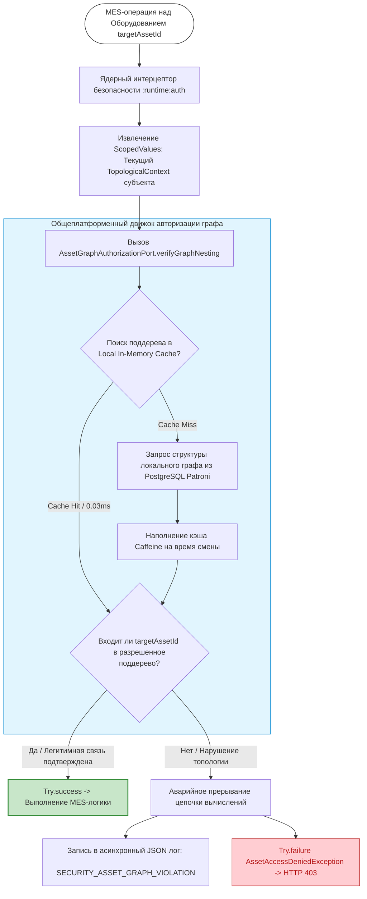

# Спецификация требований к архитектурным механизмам предоставления доступа на основе объектной модели Asset Framework

**Редакция**: 1.0.0.1

---
## 1. Архитектурный контекст и базовые инварианты
Настоящий документ специфицирует технические требования к расширению общеплатформенного модуля разрешения доступа (`AccessAuthorizationEngine`) в части использования объектной модели данных Asset Framework цифровой производственной платформы DMP СИГМА.MES+ (далее — Ядро). Документ строго ограничен механизмами авторизации, разграничения видимости и вычисления допусков на основе иерархических связей оборудования и персонала.

В рамках проектирования Ядра Asset Framework выступает не просто как справочник оборудования, а как семантический фундамент для динамической контекстной авторизации. Настоящая спецификация исключает повторение базовых принципов гексагональной изоляции (`SRS-01`), структуры OAT-токенов (`SRS-02`) и физического устройства КИИ-топологии («Снежинка») (`SRS-03`). Документ фокусируется на механизмах вычисления допускных решений, когда правила разграничения прав зависят от структуры и типов связей внутри производственного графа.

При формировании артефакта фиксируются следующие архитектурные инварианты:

1. **Авторизация на основе графовых зависимостей (`Graph-Based Access Control`):** Права субъекта на совершение MES-операции над конкретным узлом оборудования определяются его положением в полиструктурном графе активов (например, вхождение в состав цеха, линии или технологического потока).
2. **Иммутабельность контекста вычисления прав:** Графовые связи, используемые для принятия допускных решений, извлекаются на точный темпоральный срез, соответствующий времени транзакции. Вычисление производится в легковесных виртуальных потоках без мутации состояния среды исполнения.
3. **Гексагональное разделение механизмов и метаописаний:** Ядро предоставляет абстрактные контракты для проверки графовой вложенности и маскирования видимости. Конкретные типы прикладных связей и наполнение графа определяются в доменных плагинах.

------------------------------
## 2. Термины и определения

* **Полиструктурный граф активов:** Совокупность параллельно существующих иерархических деревьев связей (физическая топология, технологический поток, энергоучет и так далее), построенных над одними и теми же узлами оборудования, производственных зон, элементами организационной структуры и так далее.
* **Графовая вложенность:** Иерархическое свойство, при котором допуск субъекта к родительскому узлу графа активов автоматически транслируется (или ограничивается) на все дочерние узлы (цеха, линии, станки).
* **Контекстный граф видимости:** Динамически вычисляемый срез графа активов, содержащий только те узлы и оборудование, к которым текущий аутентифицированный субъект имеет регламентированный допуск в рамках выполняемой MES-задачи.
* **Графовая изоляция контекста выполнения:** Архитектурный механизм Ядра, гарантирующий, что транзакционные и расчетные операции прикладных модулей MES могут изменять или считывать данные только тех материальных активов, которые находятся внутри авторизованного поддерева графа для данного потока выполнения.

------------------------------
## 3. Контекст использования графовой изоляции и примеры

### 3.1. Описание контекста использования
Механизм графовой изоляции активируется Ядром в контуре `:runtime:auth` при перехвате любого прикладного бизнес-запроса, направленного на чтение состояния или модификацию параметров производственного оборудования. Поскольку в холдинге (80+ предприятий) структура цехов и связей постоянно адаптируется, Ядро не может использовать статические роли.

Вместо этого Ядро накладывает динамический трафарет (изолирующий контур) на граф активов. Субъект, входя в систему, приносит с собой «точку привязки» в иерархии (свой текущий топологический контекст). Графовая изоляция гарантирует, что любые каскадные вычисления, сбор телеметрии или диспетчеризация команд ЧПУ автоматически замыкаются в границах этого поддерева. Это исключает риски несанкционированного доступа к оборудованию смежных контуров автоматизации КИИ без необходимости дублирования кода безопасности в прикладных MES-сервисах.

### 3.2. Возможные сценарии применения

* **Пример 1 (Физическая вложенность):** Оператор (субъект) авторизован на терминале с привязкой к *Цеху №5 (родительский узел)*. При попытке вызвать метод «Запуск обработки» для *Токарного станка ЧПУ-12 (дочерний узел)* Ядро рекурсивно проверяет граф сверху вниз. Так как станок физически расположен внутри Цеха №5, проверка `verifyGraphNesting` завершается успешно.
* **Пример 2 (Технологический поток):** Наладки технологической линии проходят по цепочке «*Участок заготовки → Участок термообработки*». Сервисный аккаунт печи нагрева запрашивает статус готовности передаточного конвейера. Ядро вычисляет допуск, проверяя связанность этих элементов по графу `TECHNOLOGICAL_FLOW`. Если конвейер принадлежит смежной линии, операция блокируется.
* **Пример 3 (Изоляция при аварии):** В случае компрометации или сбоя ПО на Edge-терминале в *Корпусе Б*, графовая изоляция жестко локализует область потенциального ущерба. Вредоносные команды или фиктивные сигналы телеметрии физически не смогут затронуть активы *Корпуса А*, поскольку алгоритм обхода графа на уровне Ядра вернет отказ на границе корневых элементов этих корпусов.

------------------------------
## 4. Спецификация технических требований

### 4.1. Требования к абстрактной модели и портам (`:domain:ports`)

* **REQ-F-AF-001: Интерфейс вычисления графовых допусков**

  В слое `:domain:ports:incoming` должен быть определен специализированный интерфейс `AssetGraphAuthorizationPort`. Он расширяет базовый контур разрешения доступа Ядра и предоставляет методы для валидации прав на основе топологического и технологического взаиморасположения субъектов и объектов:

```java
package dmp.sigma.mes.core.domain.ports.incoming;
import io.vavr.control.Try;
/**
* Входящий порт ядра для вычисления авторизационных решений
* на основе графовых связей Asset Framework
  */public interface AssetGraphAuthorizationPort {

  /**
    * Проверяет, входит ли целевое оборудование в авторизованную зону видимости субъекта.
    *
    * @param subjectContext  Распределенный контекст вычислений с TopologicalContext субъекта
    * @param targetAssetId   Идентификатор узла оборудования (Asset Element), над которым совершается действие
    * @param hierarchyType   Тип графа (PHYSICAL_TOPOLOGY, TECHNOLOGICAL_FLOW) для проверки связи
    * @return Try.success(Void) если связь подтверждена и допуск разрешен,
    *         Try.failure(AssetAccessDeniedException) при отсутствии легитимной связи в графе
  */
  Try<Void> verifyGraphNesting(DistributedEvaluationContext subjectContext, String targetAssetId, String hierarchyType);
  }
```

* **REQ-F-AF-002: Декларативное абстрагирование типов иерархий**

  Инфраструктурные механизмы проверки графовой вложенности в слое выполнения обязаны быть инвариантны к бизнес-смыслу связей. Движок разрешения доступа должен оперировать абстрактными идентификаторами узлов (`assetId`) и кодами типов иерархий. Любое введение новых типов связей на уровне прикладных плагинов `:domain:plugins` не должно требовать модификации и пересборки исходного кода авторизационного движка Ядра.

### 4.2. Требования к механизмам исполнения и контекстуализации (`:runtime:auth`)

* **REQ-F-AF-003: Динамическая фильтрация областей видимости**

  Компонент `DataScopeEvaluator` в слое `:runtime:routing` обязан использовать иерархическую модель графа активов для наложения неявных ограничений на результаты прикладных MES-запросов. При выполнении поисковых и списочных запросов к структуре оборудования, Ядро на основе `TopologicalContext` текущего виртуального потока обязано автоматически ограничивать (маскировать) возвращаемые поддеревья графа активов.

  *Примеры возможных критериев маскирования эшелонов КИИ (не исчерпывающие полноту доменных определений плагинов):*

  * *Для эшелона `POS=EDG` (Цех):* Результаты запросов могут автоматически ограничиваться узлами графа, у которых родительский элемент совпадает с текущим активным `workCenterId` токена.
  * *Для эшелона `POS=BLD` (Корпус):* Доступ может предоставляться к совокупности поддеревьев всех дочерних цехов данного производственного корпуса с отсечением видимости смежных корпусов.
  * *Прикладные доменные плагины:* имеют право переопределять, расширять или комбинировать данные правила маскирования в зависимости от специфики бизнес-контекста (например, сквозной учет брака кооперантов).
  
* **REQ-F-AF-004: Изоляция графовых вычислений и защита от Context Bleeding**

  Процесс рекурсивного обхода графа активов для вычисления допускного вердикта (проверка цепочки `Parent-Child` связей) должен выполняться строго внутри пула виртуальных потоков Java Virtual Threads. Топологический контекст и промежуточные результаты обхода графа должны передаваться через иммутабельные контейнеры `ScopedValues` (JDK 25).

  Перекрестное загрязнение памяти или использование мутируемых ThreadLocal переменных категорически запрещено во избежание утечки прав между параллельными транзакциями КИИ-узлов.

* **REQ-F-AF-005: Реагирование на нарушение графовой изоляции**

  Если при вызове `verifyGraphNesting` выявляется, что MES-операция инициирована над оборудованием, физически или технологически изолированным от текущего контекста выполнения субъекта (попытка межзаводского или перекрестного логического вызова вне разрешенных правил связности), движок обязан немедленно прервать операцию.
  Ядро возвращает монадический сбой `Try.failure(AssetAccessDeniedException)`, который инфраструктурным слоем транслируется в `HTTP 403 Forbidden`, и инициирует запись в асинхронный лог с жестким маркером `[SECURITY_ASSET_GRAPH_VIOLATION]`.

### 4.3. Нефункциональные требования

* **REQ-NF-AF-010: Временные лимиты графовой авторизации**
  
  Накладные расходы авторизационного движка на вычисление вложенности и проверку прав по графу активов не должны превышать *0.03 миллисекунды* на одну операцию проверки. Высокая скорость должна обеспечиваться за счет обязательного использования локального потокобезопасного In-Memory кэша (Caffeine, TTL = 8 часов, соответствующий регламенту производственной смены) для хранения структуры контекстных поддеревьев видимости.

* **REQ-NF-AF-011: Автономность вычисления графовых допусков**

  Алгоритмы проверки графовой вложенности и фильтрации видимости оборудования обязаны сохранять 100% функциональную дееспособность локально на уровнях Производственных корпусов (`POS=BLD`) и цехов (`POS=EDG`) в условиях полной аварийной изоляции узла от центрального контура холдинга и внешних сервисов авторизации.

---
## 5. Инфраструктурные контракты REST API: Спецификация JSON-ошибок

При возникновении исключений допускного контроля и графовой изоляции, глобальный инфраструктурный обработчик Ядра (`@ControllerAdvice`) транслирует результаты монадических сбоев в строго типизированные JSON-структуры.

### Шаблон ответа Ядра об ошибке

```json
{
  "timestamp": "YYYY-MM-DDTHH:mm:ss.SSSZ",
  "status": 403,
  "error": "Forbidden",
  "errorClass": "STRING",
  "errorCode": "STRING",
  "incidentMarker": "[SECURITY_INCIDENT_MARKER]",
  "message": "Человекочитаемое описание отказа для прикладного слоя",
  "path": "/api/v1/resource",
  "evaluationContext": {
    "nodeExecutionLevel": "EDG|BLD|LOC|CTR",
    "plantId": "STRING",
    "traceId": "STRING"
  }
}
```

### Индикативные примеры ответов Ядра

#### 1. Исключение графовой изоляции (`AssetAccessDeniedException`)

* **Сценарий**: Оператор пытается активировать станок, который по структуре Asset Framework не привязан к его текущему авторизованному цеху (`REQ-F-AF-005`).
* **HTTP-статус**: 403 Forbidden.

```json
{
  "timestamp": "2026-10-09T15:25:01.004Z",
  "status": 403,
  "error": "Forbidden",
  "errorClass": "AUTHORIZATION_FAILURE",
  "errorCode": "ASSET_GRAPH_VIOLATION",
  "incidentMarker": "[SECURITY_ASSET_GRAPH_VIOLATION]",
  "message": "Access denied: Target asset element 'CNC-TUR-12' is outside the authorized physical or technological subgraph for the current context.",
  "path": "/api/v1/shopfloor/equipment/CNC-TUR-12/activate",
  "evaluationContext": {
    "nodeExecutionLevel": "EDG",
    "plantId": "MZ-SATURN",
    "traceId": "a18f44d180b94321"
  }
}
```

#### 2. Нарушение доменных политик допуска (`PolicyViolationException`)

* **Сценарий**: Запрос отклонен движком OPA PDP из-за попытки выполнения операции вне рамок активной производственной смены сотрудника (`REQ-F-AUTH-026`, `REQ-F-AUTH-027`).
* **HTTP-статус**: 403 Forbidden.

```json
{
  "timestamp": "2026-10-09T15:26:14.881Z",
  "status": 403,
  "error": "Forbidden",
  "errorClass": "POLICY_VIOLATION",
  "errorCode": "WORK_SHIFT_MISMATCH",
  "incidentMarker": "[SECURITY_POLICY_VIOLATION]",
  "message": "Infrastructure access denied: Current timestamp is outside the scheduled operational interval for the assigned work shift.",
  "path": "/api/v1/execution/scrap/record",
  "evaluationContext": {
    "nodeExecutionLevel": "BLD",
    "plantId": "NMP-ALMAZ",
    "traceId": "b902ef2381cbb444"
  }
}
```

#### 3. Нарушение сессионности технологического ресурса (`ConcurrentResourceSessionException`)

* **Сценарий**: Промышленный ЧПУ-станок пытается установить сессию обмена данными под идентификатором, который уже активен на другом сетевом адресе (риск компрометации устройства, `REQ-F-AUTH-028`).
* **HTTP-статус**: 409 Conflict.

```json
{
  "timestamp": "2026-10-09T15:27:30.550Z",
  "status": 409,
  "error": "Conflict",
  "errorClass": "INFRASTRUCTURE_CONFLICT",
  "errorCode": "CONCURRENT_EQUIPMENT_SESSION",
  "incidentMarker": "[SECURITY_EQUIPMENT_DUPLICATE_CONNECT]",
  "message": "Authentication failed: Multiple concurrent sessions are strictly prohibited for technological resources. Active connection detected from alternative network endpoint.",
  "path": "/api/v1/telemetry/stream/init",
  "evaluationContext": {
    "nodeExecutionLevel": "EDG",
    "plantId": "VZ-PROGRES",
    "traceId": "ff30411a0de88123"
  }
}
```

#### 4. Использование отозванного кода доступа (`RevokedTokenException`)

* **Сценарий**: Ресурс предъявляет код OAT, идентификатор которого уже внесен в распределенный черный список принудительной блокировки OTRL (`REQ-F-AUTH-014`).
* **HTTP-статус**: 403 Forbidden.

```json
{
  "timestamp": "2026-10-09T15:28:05.119Z",
  "status": 403,
  "error": "Forbidden",
  "errorClass": "AUTHENTICATION_FAILURE",
  "errorCode": "OPERATIONAL_TOKEN_REVOKED",
  "incidentMarker": "[SECURITY_REVOKED_TOKEN_ATTEMPT]",
  "message": "Access denied: The presented Operational Access Token (OAT) has been explicitly revoked via OTRL before its expiration time.",
  "path": "/api/v1/materials/move",
  "evaluationContext": {
    "nodeExecutionLevel": "LOC",
    "plantId": "KMZ-STEEL",
    "traceId": "d777eb11290fa111"
  }
}
```

------------------------------
## 6. Логическая схема графовой авторизации в Ядре платформы

Схема наглядно иллюстрирует, как общеплатформенный движок Ядра использует иммутабельный контекст и семантику Asset Framework для динамической фильтрации и принятия допускных решений, не заходя в специфику прикладных плагинов.


