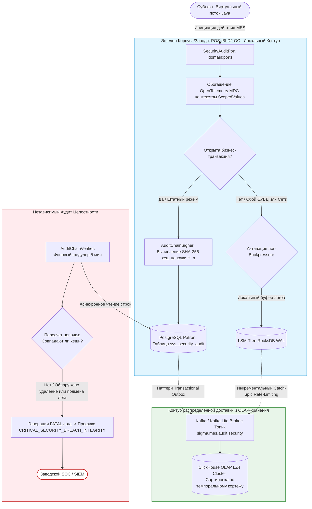

# Спецификация требований на общеплатформенные механизмы системного журналирования, трассировки и криптографического аудита безопасности

**Версия**: 1.0.0.1

------------------------------
## 1. Введение

### 1.1. Назначение

Настоящая спецификация требований определяет полные, атомарные технические требования к проектированию, реализации и развертыванию сквозных механизмов системного журналирования (`Core Logging`), распределенной трассировки (`Distributed Tracing`) и криптографически защищенного аудита безопасности (`Security Audit`) в рамках базового ядра цифровой производственной платформы DMP СИГМА.MES+ (далее — Ядро или Платформа).

Документ выступает в качестве прямого расширения базового программного каркаса (`SRS-01`) и сопутствующих инфраструктурных спецификаций ядра (`SRS-02` - `SRS-04`). Он служит строгим техническим заданием для системных инженеров и архитекторов информационной безопасности, определяя устройство портов, буферов, интерцепторов и механизмов верификации целостности журналов в условиях распределенного и гетерогенного ландшафта КИИ (свыше 80 предприятий в топологии «Снежинка»).

### 1.2. Область действия
Реализация подсистем журналирования, трассировки и безопасности охватывает следующие слои многомодульного проекта:

* **Доменный слой (`:domain:ports`, `:domain:abstraction`):** Определение унифицированных интерфейсов (портов) асинхронной фиксации логов/аудита, контрактов сериализации и неизменяемых моделей метаданных контекста.

* **Слой исполнения (`:runtime:execution`):** Реализация легковесных перехватчиков, процессоров контекстов OpenTelemetry MDC, распространения Trace-ID/Span-ID внутри пула виртуальных потоков Java (Java Virtual Threads) через механизмы `ScopedValues`.

* **Инфраструктурно-ресурсную группу (`:infrastructure:core`, `:infrastructure:resources`):** Реализация высокопроизводительных JSON-аппендеров, локальных транзакционных буферов `Transactional Outbox`, LSM-буферов RocksDB для Edge-эшелонов, а также схем хранения и партиционирования в PostgreSQL Patroni и ClickHouse LZ4.

* **Контур криптографического контроля:** Разработка ядерных механизмов потокового вычисления хеш-цепочек SHA-256 событий безопасности для детерминированного выявления нарушений целостности журналов.

---
## 2. Термины, определения и сокращения

| Термин | Определение |
|---|---|
| **Системное журналирование** | Процесс автоматической асинхронной фиксации технических событий функционирования Платформы (информационные сообщения, предупреждения, ошибки фреймворков и СУБД) в структурированном формате JSON. |
| **Аудит безопасности** | Изолированный, криптографически защищенный контур регистрации событий, напрямую влияющих на состояние ИБ (успешная аутентификация, отказы в допуске OPA, изменение конфигураций, компрометация токенов). |
| **Распределенная трассировка** | Механизм сквозного отслеживания пути прохождения запроса сквозь распределенные эшелоны топологии Платформы с генерацией уникальных сквозных маркеров (`TraceID` и `SpanID`). |
| **Криптографическая хеш-цепочка** | Метод линеаризации и защиты данных, при котором хеш каждой новой записи вычисляется от конкатенации полезной нагрузки текущего события и криптографического хеша предыдущей строки. |
| **Маркер инцидента безопасности** | Жестко стандартизированный текстовый тег-префикс в теле лога, предназначенный для автоматической фильтрации, парсинга и мгновенной маршрутизации событий внешними SIEM/SOC системами. |
| **Сглаживающий буфер логирования** | Механизм контролируемого переключения Ядра в режим локального накопления журналов в LSM-структурах при деградации или отказе центральных шин доставки сообщений. |

------------------------------
## 3. Архитектурный контекст и обоснование технических решений

Для обеспечения полноты спецификации каждое ключевое техническое решение снабжено прагматичным архитектурным обоснованием:

* **Зачем логи разделены на контуры Core и Security?**
  *Обоснование:* Смешивание отладочных логов приложений с журналами безопасности приводит к рискам засорения, снижает производительность СИБ при анализе инцидентов и нарушает требования регуляторов по изоляции данных аудита КИИ. Разделение потоков на уровне Ядра гарантирует, что технические логи (`INFO`/`DEBUG`) могут подвергаться стандартной агрессивной ротации, тогда как журналы безопасности защищены хешированием и подлежат строгому обособленному долгосрочному хранению.
* **Зачем передавать Trace-ID через `ScopedValues` (JDK 25) вместо `ThreadLocal`?**
  *Обоснование:* Традиционный `ThreadLocal` жестко привязывает контекст трассировки к физическому потоку ОС. В парадигме Project Loom один поток ОС поочередно выполняет миллионы виртуальных потоков. Использование `ThreadLocal` привело бы к критической ошибке — перекрестному загрязнению данных, когда Trace-ID одного предприятия или пользователя утек бы в логи другой транзакции. Механизм `ScopedValues` гарантирует абсолютную неизменяемость и жесткую изоляцию контекста трассировки в рамках области выполнения конкретного легковесного потока.
* **Зачем внедрять линейную хеш-цепочку SHA-256 для Security-логов?**
  *Обоснование:* В распределенной системе КИИ существует риск компрометации периферийного узла (например, на уровне Производственного корпуса `POS=BLD`). Злоумышленник, получив права суперпользователя на операционной системе узла, может попытаться удалить из локальной БД строки журнала, свидетельствующие о несанкционированном доступе или изменении конфигурации. Наличие линейной математической зависимости делает незаметное удаление или модификацию исторических записей физически невозможным: любое вмешательство мгновенно разрушает целостность всей последующей цепочки, что сразу фиксируется фоновым верификатором и SOC.
* **Зачем логировать через `Transactional Outbox` в PostgreSQL и дублировать в RocksDB?**
  *Обоснование:* Прямая синхронная отправка логов по сети в центральную Kafka в момент выполнения бизнес-операции недопустима, так как сетевые задержки заблокируют выполнение MES-задач. Запись лога безопасности должна быть атомарна с самой операцией (если упала бизнес-транзакция, лог попытки тоже должен откатиться, либо зафиксироваться со статусом `Fail`). Паттерн `Transactional Outbox` в PostgreSQL Patroni гарантирует консистентность. Если же падает сам локальный экземпляр PostgreSQL или отключается электропитание, Ядро перенаправляет поток логов в локальный буфер RocksDB WAL, который устойчив к нарушениям питающей сети, предотвращая безвозвратную потерю информации.

------------------------------
## 4. Конкретные требования

### 4.1. Функциональные требования

#### 4.1.1. Подсистема распределенной трассировки и контекстуализации

* **REQ-F-LOG-001: Унифицированная структура контекста трассировки**

  В слое `:domain:abstraction` Ядра должна быть определена неизменяемая модель контекста трассировки в виде Java Record `TraceContext`. Структура обязана бесшовно интегрировать параметры распределенной трассировки `OpenTelemetry` с ядерным топологическим контекстом `TopologicalContext`:
    * `traceId` — уникальный 128-битный идентификатор распределенной трассировки (Hex-строка, 32 символа);
    * `spanId` — уникальный 64-битный идентификатор текущего шага вычислений (Hex-строка, 16 символов);
    * `parentSpanId` — идентификатор вызывающего шага (опционально);
    * `topologicalContext` — неизменяемая ссылка на Java Record `TopologicalContext` текущего узла КИИ;
    * `clientId` — верифицированный Client ID вызывающего узла или системы согласно регулярному выражению `REQ-F-AUTH-004`.

* **REQ-F-LOG-002: Процессор контекста трассировки в виртуальных потоках**

  Слой исполнения (`:runtime:execution`) обязан предоставлять компонент `VirtualThreadTraceProcessor`. Компонент обеспечивает привязку и автоматическое распространение экземпляра `TraceContext` при порождении новых Java Virtual Threads. Передача контекста по цепочке вызовов методов, портов и асинхронных задач должна осуществляться строго через иммутабельные контейнеры `ScopedValues`. Наличие мутируемых переменных `ThreadLocal` в контуре трассировки запрещено.

* **REQ-F-LOG-003: Автоматическое внедрение контекста в MDC (Mapped Diagnostic Context)**

  Ядро обязано на уровне инфраструктурных интерцепторов безопасности обеспечивать автоматическое обогащение диагностического контекста логирования (MDC). Каждая техническая или операционная запись, генерируемая логгерами (SLF4J/Logback), должна автоматически содержать поля `trace_id`, `span_id`, `plant_id`, `building_id` и `work_center_id`.

#### 4.1.2. Подсистема системного журналирования

* **REQ-F-LOG-004: Стандартизация формата структурированного JSON-лога**

  Инфраструктурный слой (`:infrastructure:core`) обязан переопределить стандартный вывод консоли и файлов в унифицированный структурированный формат JSON (одна строка — одно событие). Запрещен вывод неструктурированного текстового лога. Обязательный состав полей JSON-объекта системного лога:

```json
{
  "timestamp": "2026-10-09T16:40:02.115Z",
  "level": "INFO|WARN|ERROR|DEBUG",
  "traceId": "a18f44d180b94321b902ef2381cbb444",
  "spanId": "c3be992c67f80456",
  "threadId": "virtual-142",
  "loggerName": "dmp.sigma.mes.core.runtime.execution.Processor",
  "message": "Текст технического сообщения",
  "topology": {
    "nodeLevel": "BLD",
    "plantId": "MZ-SATURN",
    "buildingId": "BLD-05"
  },
  "exception": {
    "className": "java.lang.IllegalArgumentException",
    "message": "Ошибка валидации параметров",
    "stackTrace": "..."
  }
}
```

* **REQ-F-LOG-005: Управление динамическими уровнями логирования компонентов**

  Ядро Платформы в слое `:runtime:routing` должно предоставлять декларативный порт управления уровнями логирования `LoggingLevelConfigurationPort`. Механизм доставки конфигураций обязан обеспечивать горячую перезагрузку конфигурационных профилей уровней логирования для отдельных пакетов или классов на лету без перезапуска контейнеров приложений, используя иммутабельное обновление среды через `ScopedValues`.

#### 4.1.3. Подсистема аудита безопасности

* **REQ-F-LOG-006: Обособленный доменный порт аудита безопасности**

  В слое `:domain:ports:incoming` должен быть определен выделенный функциональный интерфейс `SecurityAuditPort`. Все прикладные модули MES и внутренние компоненты Ядра обязаны регистрировать события безопасности исключительно через данный порт. Интерфейс жестко локализует инфраструктурные сбои и ошибки записи через монаду `Try<Void>`:

```java
package dmp.sigma.mes.core.domain.ports.incoming;
import io.vavr.control.Try;import java.util.Map;

@FunctionalInterfacepublic interface SecurityAuditPort {

    /**
     * Атомарная неизменяемая фиксация критического события безопасности КИИ.
     *
     * @param eventType    Тип события безопасности (например, "AUTH_FAIL", "POLICY_VIOLATION")
     * @param actorId      Маскированный идентификатор субъекта (табельный номер, ID станка)
     * @param status       Статус операции (SUCCESS или FAIL)
     * @param detailParams Набор дополнительных технических параметров и контекста среды
     * @return Try.success(Void) при успешной фиксации в транзакционном буфере,
     *         или Try.failure(AuditStorageException) при критическом сбое персистентности
     */
    Try<Void> logSecurityEvent(String eventType, String actorId, String status, Map<String, Object> detailParams);
}
```

* **REQ-F-LOG-007: Строгие правила конфиденциальности и маскирования данных в аудит-логе**

  При фиксации событий безопасности через `SecurityAuditPort` категорически запрещено записывать в открытом виде коммерческую тайну, пароли, секреты клиентов и персональные данные (ПДн) сотрудников. Порт на уровне входного адаптера обязан выполнять правила маскирования и автоматической токенизации согласно `REQ-F-AUTH-009`:
   * Табельные номера сотрудников внутри контура завода (`POS=LOC`) логируются в исходном виде (при наличии согласия), но при выходе логов на верхний эшелон Холдинга (`POS=CTR`) они обязаны автоматически замещаться необратимым криптографическим хешем SHA-256 с солью `SECURITY_AUDIT_SECRET_KEY`.
   * Тела JWT или OAT токенов в лог не записываются — фиксируется только их уникальный `UUID` идентификатор (`ti` из CBOR/JSON схемы токена).

* **REQ-F-LOG-008: Матрица обязательных типов событий ИБ и жестких SIEM-маркеров**

  Ядро обязано гарантировать, что при возникновении нарушений допускного контроля или сбоях инфраструктуры, записи в журнал безопасности формируются с жестко стандартизированными текстовыми маркерами-префиксами для автоматической фильтрации внешними SIEM/SOC системами завода:

| Категория события | Код типа события (eventType) | Стандартизированный SIEM-маркер (incidentMarker) | Условие генерации Ядром |
|---|---|---|---|
| **Нарушение графовой изоляции** | `ASSET_GRAPH_VIOLATION` | `[SECURITY_ASSET_GRAPH_VIOLATION]` | Попытка MES-операции над оборудованием вне разрешенного поддерева Asset Framework. |
| **Отказ доменной политики** | `POLICY_VIOLATION` | `[SECURITY_POLICY_VIOLATION]` | Запрет выполнения действия по результатам вычисления OPA-политик (чужая смена и т.д.). |
| **Конкурентная сессия станка** | `EQUIPMENT_CONCURRENCY` | `[SECURITY_EQUIPMENT_DUPLICATE_CONNECT]` | Фиксация дублирующего подключения ЧПУ-станка с отличного сетевого адреса. |
| **Использование отозванного кода** | `REVOKED_TOKEN_ATTEMPT` | `[SECURITY_REVOKED_TOKEN_ATTEMPT]` | Попытка авторизации по коду OAT, находящемуся в списках отзыва OTRL. |
| **Неизвестный аппаратный ключ** | `UNKNOWN_KEY_ACCESS` | `[SECURITY_UNKNOWN_KEY_ATTEMPT]` | Считывание карты СКУД или ID устройства, отсутствующего в локальных базах связок. |
| **Сбой целостности журналов** | `LOG_INTEGRITY_BREACH` | `[CRITICAL_SECURITY_BREACH_INTEGRITY]` | Выявление расхождения математического хеша при фоновой валидации цепочки логов. |

#### 4.1.4. Механизмы криптографического контроля целостности журналов безопасности

* **REQ-F-LOG-009: Математическая линеаризация записей аудита (Хеш-цепочка)**

  Каждая запись, сохраняемая в таблице аудита безопасности, обязана снабжаться бинарным полем `record_hash`. Расчет контрольной суммы текущей записи должен осуществляться потоковым алгоритмом SHA-256 от конкатенации полей текущего события (Timestamp + EventType + ActorId + Status + Message + TraceId) и значения `record_hash` непосредственно предыдущей записи в таблице:
  $$H_n = SHA256(Data_n + H_{n-1})$$
  Вычисление выполняется в изоляции внутри слоя `:runtime:auth` с использованием локального секретного ключа узла системы, подаваемого на этапе старта контейнера через защищенную переменную среды `SECURITY_AUDIT_SECRET_KEY`.

* **REQ-F-LOG-010: Фоновое асинхронное тестирование целостности журналов**

  Ядро в инфраструктурном модуле должно содержать асинхронный шедулер `AuditChainVerifier`, запускаемый в изолированном виртуальном потоке по настраиваемому интервалу (по умолчанию — каждые 5 минут). Компонент выполняет последовательный пересчет хеш-цепочки записей безопасности за последний скользящий интервал времени. При обнаружении математического несовпадения (факт удаления строки или модификации ячейки БД) компонент обязан:
    1. Немедленно прервать цикл проверки;
    2. Сгенерировать критический системный лог уровня `FATAL` с жестким маркером `[CRITICAL_SECURITY_BREACH_INTEGRITY]`;
    3. Вызвать локальный монадический эффект уведомления SOC-адаптера.

#### 4.1.5. Отказоустойчивость, гарантированная доставка и Backpressure журналов

* **REQ-F-LOG-011: Реализация паттерна Transactional Outbox для логов безопасности**

  Фиксация события безопасности в рамках `SecurityAuditPort` обязана выполняться в транзакционном контексте текущего бизнес-запроса MES. Запись строки лога и расчет её начального хеша осуществляются атомарно в локальную таблицу `sys_security_audit` реляционной БД PostgreSQL под управлением кластера Patroni. Прямая синхронная запись логов напрямую во внешние аналитические СУБД или удаленные брокеры сообщений категорически запрещена во избежание блокировок пула вычислений.

* **REQ-F-LOG-012: Сглаживающий буфер логирования на базе LSM-Tree RocksDB**

  Для обеспечения непрерывной фиксации событий и предотвращения деградации памяти (OOM) при высокой плотности инцидентов или отказе СУБД PostgreSQL Patroni, Ядро обязано активировать стратегию обратного давления логов **Log Backpressure Buffer-or-Block**. При переполнении внутреннего неблокирующего In-Memory кольцевого буфера логов (RingBuffer), Ядро переходит в режим аварийной буферизации, выполняя атомарный сброс структурированных событий в локальную встраиваемую СУБД RocksDB в WAL-режиме.

* **REQ-F-LOG-013: Контролируемый Catch-up и Rate-Limiting экспорта журналов**

  При восстановлении штатной работоспособности каналов связи и персистентных хранилищ, фоновый сервис Ядра обязан запустить инкрементальный контролируемый экспорт (Catch-up) накопленных логов из RocksDB в топик Apache Kafka `sigma.mes.audit.security` с подтверждением (`acks=all`). Скорость вычитки и передачи должна динамически регулироваться (Rate-Limiting) на основе метрик утилизации CPU и дискового ввода-вывода (I/O) целевого узла, полностью исключая риски возникновения «шторма обновлений» и деградации транзакционного слоя MES.

#### 4.2. Нефункциональные требования

* **REQ-NF-LOG-001: Ограничение добавочной задержки на логирование и трассировку**

  Добавочная задержка, привносимая механизмами автоматической трассировки, переключения контекстов OpenTelemetry MDC внутри виртуального потока Java и формирования структурированного JSON-объекта, не должна превышать 0.02 миллисекунды на одно событие логирования при максимальной плотности входящего потока данных до 100 000 сигналов/операций в секунду на один цеховой узел ноды.

* **REQ-NF-LOG-002: Сроки персистентного хранения и глубина архивов логов в КИИ-топологии**

  Глубина удержания и хранения журналов в СУБД настраивается статически на этапе сборки и запуска узлов КИИ без возможности изменения параметров «на лету» в соответствии со следующими регламентами:
    * **На эшелоне Производственных корпусов (`POS=BLD`):** Глубина удержания локального транзакционного буфера логов безопасности в PostgreSQL Patroni составляет не менее 30 суток (720 часов) для обеспечения полной автономности в условиях Mesh-изоляции от завода.
    * **На эшелоне Локальных узлов завода (`POS=LOC`):** Глубина хранения детальных и дедуплицированных журналов в локальном аналитическом кластере ClickHouse составляет не менее 1 календарного года.
    * **На эшелоне Центрального контура холдинга (`POS=CTR`):** Глубина агрегированного хранения кросс-заводских журналов безопасности в глобальном ClickHouse составляет не менее 3 лет.

* **REQ-NF-LOG-003: Производительность записи в транзакционный буфер аудит-лога**

  Операция формирования, расчета хеш-сумм SHA-256 и вставки (INSERT) записи события безопасности в локальную Outbox-таблицу PostgreSQL Patroni, выполняемая внутри пула Java Virtual Threads, должна занимать не более 2 миллисекунд, полностью исключая блокировки прикладных потоков выполнения бизнес-логики MES.

* **REQ-NF-LOG-004: Требования к покрытию автоматизированными тестами**

  Архитектурные компоненты подсистемы логирования и трассировки должны быть покрыты эталонными заготовками тестов в рамках многомодульного проекта:
    * *Unit-тесты (JUnit 5 + AssertJ):* 100% покрытие алгоритмов вычисления хеш-цепочек AuditChainSigner и процессора контекстов трассировки без поднятия контекста Spring.
    * *Интеграционные тесты (Testcontainers):* Проверка сквозной транзакционной изоляции, атомарности записи Outbox логов в PostgreSQL Patroni и устойчивости RocksDB-буфера логов к искусственной потере сетевого соединения с брокерами Kafka.

---
## 5. Инфраструктурная схема хранения и партиционирования журналов

Для долгосрочного хранения и высокоскоростного анализа битемпоральных рядов системных логов и логов безопасности на эшелонах завода (`POS=LOC`) и холдинга (`POS=CTR`) используется ClickHouse.

### 5.1. Параметры конфигурации таблиц ClickHouse

* **Алгоритм сжатия:** Блоки данных сжимаются по умолчанию высокопроизводительным алгоритмом LZ4.
* **Движок таблиц:** Применяется семейство движков `ReplacingMergeTree`. В качестве явной версии актуализации строк выступает системное время регистрации события `TransactionTime` (запись в СУБД).
* **Ключ сортировки (`ORDER BY`):** Сортировка и индексация физических блоков на диске осуществляются на основе темпорально-топологического кортежа метаданных:
  $$\text{ORDER BY } (plantId, buildingId, eventType, ValidTime, TransactionTime)$$
* **Партиционирование (`PARTITION BY`):** Автоматическое горизонтальное секционирование таблиц логов выполняется по временному признаку `TransactionTime (Год, Месяц)`, изолируя исторические архивы и оптимизируя скорость выполнения аналитических срезов СИБ.

---
## 6. Логическая архитектурная модель потоков логирования и аудита КИИ
На схеме представлена логическая топология движения технических логов и защищенных журналов безопасности с обеспечением сквозной трассировки и криптографического контроля целостности.


